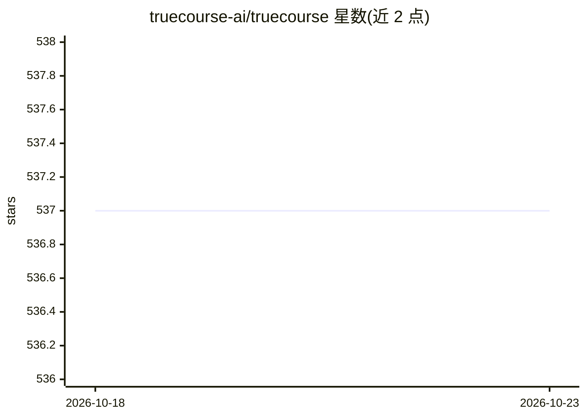

# truecourse-ai/truecourse

⭐ 537 · TypeScript · MIT · 推送 2026-10-14 · [GitHub](https://github.com/truecourse-ai/truecourse) · [官网](https://truecourse.dev) · 组织维护

**把团队已有文档转化为可运行的端到端测试（基于 Claude Code）**

面向产品团队的文档一致性测试工具：读取 PRD、ADR、README 或文档站点，将文档整理为声明语料，推导用户流程，通过 Claude Code 会话（默认 claude-opus-5-5 模型）克隆并启动仓库的真实产品，编写 Playwright 测试并运行；失败的测试指出产品与文档不一致的具体声明。测试可自动修复或转为发现项，并经新上下文审查者复核。提供 GitHub App 的 PR 检查（默认关闭）、MCP 端点供 Claude Code 读取工作区。注意：npm CLI 包已声明弃用，产品正转向面向产品负责人的 IDE；MIT 许可但 `ee/` 目录除外。

## 筛选速览

| 维度 | 判定 | 备注 |
|---|---|---|
| AI 角色 | `ai-ecosystem` | LLM/agent 周边工具 |
| 许可风险 | `permissive` | MIT |
| 部署形态 | `self-host` | docker 或自建部署 |
| 模型依赖 | locked-api |  |
| 硬件要求 | — | 无带数字的原话,不猜 |
| 安装摩擦 | `low` | 无编译、无系统依赖或容器化 |
| 成熟度 | — | 结构信号不足 |

## 能力要点

- 从文档抽取声明并推导用户流程，生成 Playwright 端到端测试
- 失败测试定位到具体文档声明并区分修复/发现项
- 提供 MCP 端点（/mcp）供 Claude Code 读取工作区
- GitHub App 检查 PR 中的文档冲突与测试失败

## 适用场景

- 验证产品功能是否与文档承诺一致
- 在 PR 检查中报告文档冲突与测试失败
- 让产品负责人把现有文档转成端到端测试

## 场景标签

 · 领域:开发者工具/测试自动化

## 证据(README 行号)

> L20: It curates those documents into a corpus of **claims**, works out the **flows** a
> L50: TrueCourse runs on your Claude Code login, so it needs the `claude` binary on
> L83: TrueCourse checks pull requests for documentation conflicts and test failures,

## 星数曲线

2026-10-18 537 → 2026-10-23 537（+0）

---
*卡片 v1 · prompt 1.4 · 生成 2026-10-21 · 置信度 mid · 依据 README sha `997ef9f36044` · [字段定义](../../DATASET.md)*
