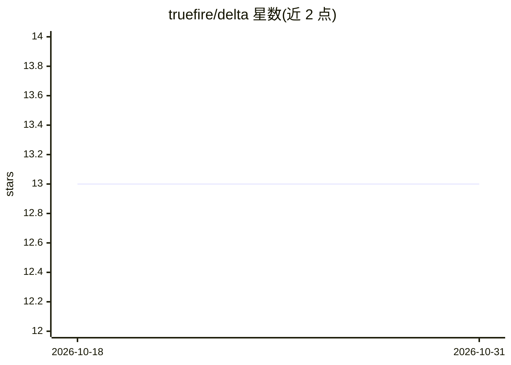

# truefire/delta

⭐ 13 · Python · MIT · 推送 2026-06-05 · [GitHub](https://github.com/truefire/delta) · [官网](https://github.com/truefire/delta-private) · 个人维护

**面向资深工程师的极简 LLM 代码编辑器（GUI+CLI）**

一个由 LLM 驱动的最小化代码编辑器，非 IDE 也非 agent：用户指定若干文件并下达修改指令，它据此新建或编辑文件。核心机制包括手动上下文控制（选择纳入上下文的文件）、模糊搜索替换式补丁算法、文件或 Git 备份与一键回滚、修改后自动运行测试/lint 的验证循环、可视化 diff 审查。提供 ImGui 风格 GUI 与 CLI 子命令，通过标准 OpenAI 客户端库连接任意 OpenAI 兼容 API（OpenRouter、Ollama、LM Studio、vLLM 等）。注意：README 顶部声明作者本人已推荐改用 Claude Code 等 agentic 工具。

## 筛选速览

| 维度 | 判定 | 备注 |
|---|---|---|
| AI 角色 | `ai-native` | 本体是模型或模型工具 |
| 许可风险 | `permissive` | MIT |
| 部署形态 | `None` |  |
| 模型依赖 | local-ok | 支持本地模型 |
| 硬件要求 | — | 无带数字的原话,不猜 |
| 安装摩擦 | `low` | 无编译、无系统依赖或容器化 |
| 成熟度 | — | 结构信号不足 |

## 能力要点

- 模糊搜索替换算法以 LLM 感知方式应用补丁
- 手动上下文控制：精确指定纳入上下文的文件
- 自动备份（文件/Git）与一键回滚，修改后可自动运行测试/lint 验证
- GUI 与 CLI 双入口，兼容任意 OpenAI 兼容 API

## 适用场景

- 指定文件并让 LLM 直接完成新建或修改的监督式编码
- 作为主编辑器旁的'第二屏'GUI 快速改代码
- 在终端中以子命令集成进其他工具流程

## 场景标签

`代码生成` · 领域:编码与开发

## 证据(README 行号)

> L10: Delta is a minimal LLM-powered code editor. It is not an IDE, nor is it an agent. It is a tool that you point at so
> L14: Delta is designed for experienced developers who find the act of pointing the LLM in the right direction and evalua

## 星数曲线

2026-10-18 13 → 2026-10-31 13（+0）

---
*卡片 v1 · prompt 1.4 · 生成 2026-10-31 · 置信度 high · 依据 README sha `d877fc7bdc7b` · [字段定义](../../DATASET.md)*
