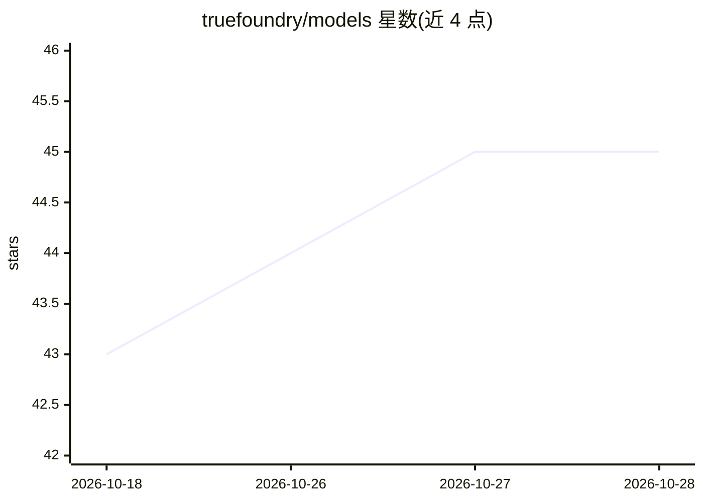

# truefoundry/models

⭐ 45 · Python · MIT · 推送 2026-10-27 · [GitHub](https://github.com/truefoundry/models) · [官网](https://www.truefoundry.com/models) · 组织维护

**社区维护的 AI/LLM 模型元数据注册表：24 家提供商的定价与限制**

TrueFoundry 维护的社区注册表，收录 LLM Gateway 已接入提供商的模型配置元数据，覆盖 24 家提供商、1000+ 模型，以统一 YAML schema（CUE 校验）描述定价、token 限制、功能（vision/tools/结构化输出）与模态，目录按 providers/<name>/ 组织。范围限于元数据：新增/更新已有提供商下的模型走 PR，新增提供商属于网关侧工作、仅接受 issue。仅提供 git clone 获取方式，MIT 许可。

## 筛选速览

| 维度 | 判定 | 备注 |
|---|---|---|
| AI 角色 | `ai-knowledge` | 知识聚合/清单类 |
| 许可风险 | `permissive` | MIT |
| 部署形态 | `None` |  |
| 模型依赖 | — | README 未给出锁定关系 |
| 硬件要求 | — | 无带数字的原话,不猜 |
| 安装摩擦 | `low` | 无编译、无系统依赖或容器化 |
| 成熟度 | — | 结构信号不足 |

## 能力要点

- 24 家提供商、1000+ 模型的统一定元数据 schema（YAML，CUE 校验）
- 记录输入/输出 token 定价、批处理与缓存计费、功能与限制
- README 提供商表由 update-readme-counts.ts 自动生成
- 支持 canonical_model 与外部 ID 交叉引用，CI 校验一致性

## 适用场景

- 为 LLM 网关/计费系统查找各提供商模型的最新定价与限制
- 查询某模型是否支持 vision、工具调用、结构化输出
- 通过 PR 更新过期的模型配置数据

## 场景标签

 · 领域:LLM 基础设施/元数据

## 证据(README 行号)

> L6: A comprehensive, community-maintained registry of AI/LLM model configurations. This repository provides standardized
> L10: This registry is **metadata only**, for providers the TrueFoundry LLM Gateway already integrates with. Every direct

## 星数曲线

2026-10-18 43 → 2026-10-28 45（+2）

---
*卡片 v1 · prompt 1.4 · 生成 2026-10-25 · 置信度 high · 依据 README sha `88f4d056714c` · [字段定义](../../DATASET.md)*
