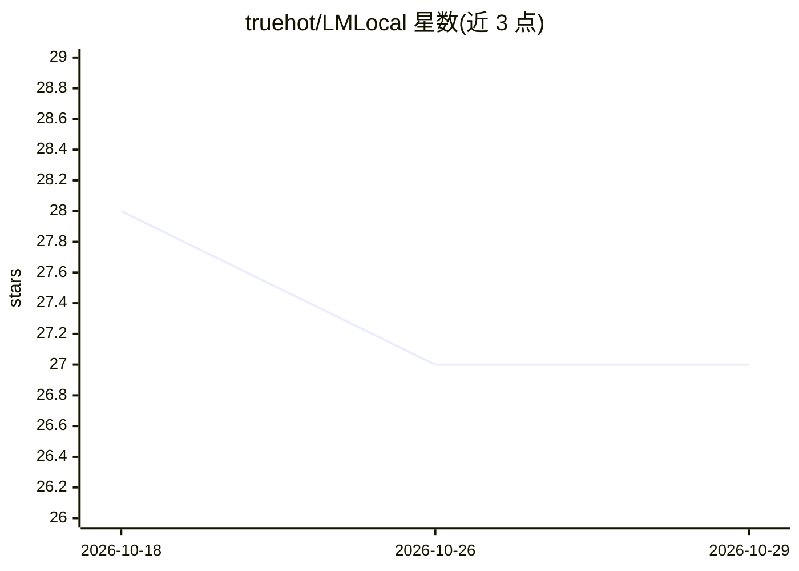

# truehot/LMLocal

⭐ 27 · C# · NOASSERTION · 推送 2026-10-26 · [GitHub](https://github.com/truehot/LMLocal) · 个人维护

**Visual Studio 的 AI 编程助手扩展，支持本地与云端模型**

面向 Visual Studio 2022/2026 用户的 AI 编程助手扩展，提供 IDE 内聊天、代码自动补全、agentic 文件编辑、构建/测试执行与专门 subagent。后端可接本地引擎（LM Studio、Ollama、Jan、Llama.cpp、Unsloth）及任意 OpenAI 兼容云端 API，内置 Ollama、Groq、OpenRouter、Google AI Studio、DeepSeek 的专属 provider 适配。默认关闭写入工具，修改经 Changes 面板追踪并支持一键回滚；支持 MCP 扩展、模型热切换、会话历史恢复。通过 VS Marketplace 或手动 VSIX 安装，依赖 Edge WebView2。

## 筛选速览

| 维度 | 判定 | 备注 |
|---|---|---|
| AI 角色 | `ai-native` | 本体是模型或模型工具 |
| 许可风险 | `none` | NOASSERTION |
| 部署形态 | `desktop` | 安装包/桌面程序 |
| 模型依赖 | local-ok | 支持本地模型 |
| 硬件要求 | — | 无带数字的原话,不猜 |
| 安装摩擦 | `high` | 编译与系统依赖俱全 |
| 成熟度 | — | 结构信号不足 |

## 能力要点

- IDE 内聊天 + agentic 文件编辑 + 行级 AI 补全
- 内置 Ollama/Groq/OpenRouter/DeepSeek 等 provider 适配，兼容任意 OpenAI 兼容 API
- 默认禁用写入工具，修改经 Changes 面板追踪、一键回滚
- MCP 扩展（stdio/http）与专门 subagent 机制

## 适用场景

- 在 Visual Studio 里用本地模型做代码对话与自动补全
- 让 AI 代理执行构建、测试与代码修改并随时回滚
- 通过 MCP 接入外部工具扩展能力

## 场景标签

`代码生成` `编码 Agent` · 领域:编码与开发

## 证据(README 行号)

> L3: **LM Local** is an AI coding assistant for Visual Studio 2022/2026 with agentic capabilities. It works with local en
> L27: - **💬 Chat & Agentic Actions** – In‑IDE chat with streaming, agentic file edits, builds/tests, manual rollback via 
> L128: - ⌨️ **AI Inline Autocompletions** – AI‑powered line completion. When your cursor is at the end of a line, the AI 

## 星数曲线

2026-10-18 28 → 2026-10-29 27（-1）

---
*卡片 v1 · prompt 1.4 · 生成 2026-10-26 · 置信度 high · 依据 README sha `e721d829b5e4` · [字段定义](../../DATASET.md)*
