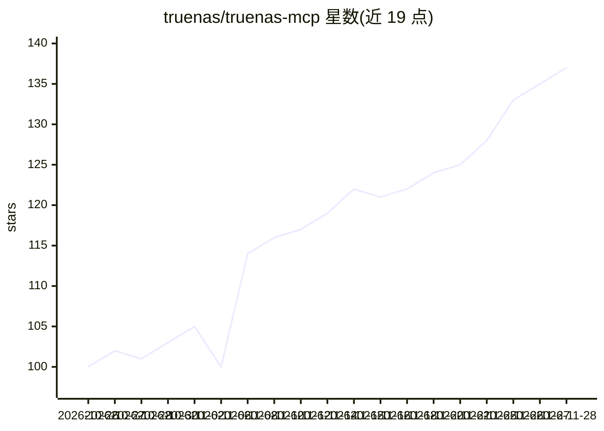

# truenas/truenas-mcp

⭐ 137 · Go · GPL-3.0 · 推送 2026-11-27 · [GitHub](https://github.com/truenas/truenas-mcp) · [官网](https://truenas.com) · 组织维护

**让 Claude 等 AI 助手用自然语言监控管理 TrueNAS 的 MCP 服务器**

一个 MCP 服务器程序，运行在用户本地，通过 WebSocket 连接 TrueNAS API，把系统监控、存储管理、快照、应用、网络、虚拟机等操作暴露为 MCP 工具，供 Claude Desktop、Claude Code、Cursor 等 MCP 客户端以自然语言调用。提供 `--read-only` 模式隐藏全部写操作，破坏性操作需显式确认，回传内容中密钥被脱敏。以多平台预编译二进制分发，也可用 Go 从源码构建；要求 TrueNAS 25.10 或以上版本，项目处于 early access 阶段。

## 筛选速览

| 维度 | 判定 | 备注 |
|---|---|---|
| AI 角色 | `ai-ecosystem` | LLM/agent 周边工具 |
| 许可风险 | `viral` | GPL-3.0 |
| 部署形态 | `desktop` | 安装包/桌面程序 |
| 模型依赖 | locked-api |  |
| 硬件要求 | — | 无带数字的原话,不猜 |
| 安装摩擦 | `low` | 无编译、无系统依赖或容器化 |
| 成熟度 | `idea` | |

## 能力要点

- 覆盖监控、存储、快照、应用、网络、目录服务、虚拟机等 TrueNAS 管理工具集
- 只读模式、破坏性操作确认、密钥脱敏三重安全机制
- 多平台预编译二进制（macOS/Linux/Windows），并提供 checksums 校验
- setup 命令一键生成 API key 与客户端配置片段

## 适用场景

- 用自然语言查询 TrueNAS 的系统健康、磁盘与告警状态
- 通过对话管理数据集、SMB/NFS 共享与快照任务
- 为 AI 助手配置受限权限的运维通道（专用 API key 所有者）

## 场景标签

 · 领域:系统运维/存储管理工具

## 证据(README 行号)

> L6: An MCP server for TrueNAS. It runs on your computer, connects to the TrueNAS API, and lets an AI assistant such as C
> L63: If you used `truenas-mcp setup`, paste the snippet it printed (`--print-config` picks `claude-desktop`, `claude-cod
> L103: ## For AI assistants

## 星数曲线

2026-10-26 100 → 2026-11-28 137（+37）

---
*卡片 v1 · prompt 1.4 · 生成 2026-11-28 · 置信度 high · 依据 README sha `89689ab6704f` · [字段定义](../../DATASET.md)*
