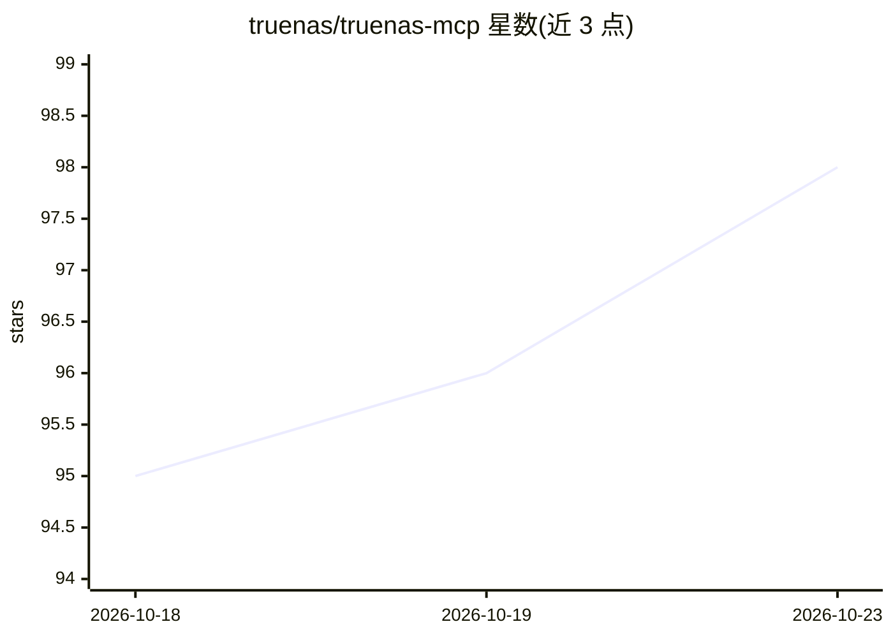

# truenas/truenas-mcp

⭐ 98 · Go · GPL-3.0 · 推送 2026-07-22 · [GitHub](https://github.com/truenas/truenas-mcp) · [官网](https://truenas.com) · 组织维护

**让 AI 通过 MCP 用自然语言管理 TrueNAS 的服务器工具**

由 TrueNAS 团队维护的 MCP 服务器，以单一原生二进制运行在用户桌面，通过安全 WebSocket (wss://) 直连 TrueNAS 中间件 API，使 Claude Desktop/Claude Code 等 MCP 客户端能用自然语言监控系统健康、管理存储池/数据集/快照/共享、虚拟机、应用升级与目录服务等。写操作支持 dry_run 预览与任务跟踪，内置危险操作校验；仅支持加密连接，API key 经 ws:// 会被吊销。项目自述为研究预览版，不建议生产使用。

## 筛选速览

| 维度 | 判定 | 备注 |
|---|---|---|
| AI 角色 | `ai-ecosystem` | LLM/agent 周边工具 |
| 许可风险 | `viral` | GPL-3.0 |
| 部署形态 | `desktop` | 安装包/桌面程序 |
| 模型依赖 | — | README 未给出锁定关系 |
| 硬件要求 | — | 无带数字的原话,不猜 |
| 安装摩擦 | `low` | 无编译、无系统依赖或容器化 |
| 成熟度 | `idea` | |

## 能力要点

- 单一原生二进制，桌面运行，wss:// 直连 TrueNAS 中间件
- 覆盖监控/存储/虚拟化/目录服务/应用管理等类别
- 写操作支持 dry-run 预览与 MCP Tasks 长任务跟踪
- 仅允许加密连接，凭据在日志中以 [REDACTED] 脱敏

## 适用场景

- 在 Claude Desktop 中用自然语言查询存储池健康与系统指标
- 通过对话创建数据集、安排 scrub 计划或升级应用
- 以 dry-run 模式预览变更后再执行 TrueNAS 管理操作

## 场景标签

 · 领域:存储系统管理/LLM 工具接入

## 证据(README 行号)

> L6: A Model Context Protocol (MCP) server for TrueNAS that enables AI models to interact with the TrueNAS API using natu
> L35: **Single native binary** that runs on your desktop and connects directly to TrueNAS:

## 星数曲线

2026-10-18 95 → 2026-10-23 98（+3）

---
*卡片 v1 · prompt 1.4 · 生成 2026-10-23 · 置信度 high · 依据 README sha `3deb514c3840` · [字段定义](../../DATASET.md)*
