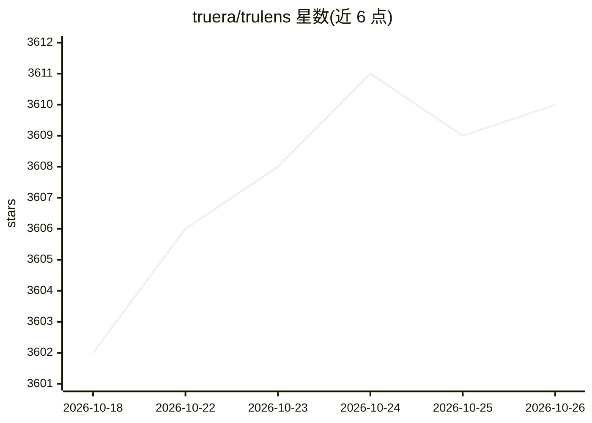

# truera/trulens

⭐ 3,610 · Python · MIT · 推送 2026-10-25 · [GitHub](https://github.com/truera/trulens) · [官网](https://www.trulens.org/) · 组织维护

**面向 LLM 应用与 AI Agent 的评估与追踪（追踪/评测）开源工具**

TruLens 是 LLM 实验与 AI Agent 的评估与追踪框架：通过装饰器对应用插桩，记录每步的延迟、输入输出、token 与成本，追踪基于 OpenTelemetry，trace 可导出至 Jaeger、Grafana Tempo、Datadog 等 OTLP 后端；提供 7 个面向 Agent 的评测器（逻辑一致性、工具选择等）、LLM-as-judge 反馈评分、版本对比排行榜，支持内联与离线批量评估，以及 MCP 工具调用插桩。以 pip 包分发，可按需安装各 LLM provider 与应用框架（LangChain/LlamaIndex）集成包。

## 筛选速览

| 维度 | 判定 | 备注 |
|---|---|---|
| AI 角色 | `ai-ecosystem` | LLM/agent 周边工具 |
| 许可风险 | `permissive` | MIT |
| 部署形态 | `library` | 以包/库形式分发 |
| 模型依赖 | locked-api |  |
| 硬件要求 | — | 无带数字的原话,不猜 |
| 安装摩擦 | `low` | 无编译、无系统依赖或容器化 |
| 成熟度 | — | 结构信号不足 |

## 能力要点

- OpenTelemetry 原生追踪，每步记录延迟/输入输出/token/成本
- 7 个 Agent 专项评测器（LogicalConsistency、ToolSelection 等）
- LLM judge 评分与人类标注对齐的基准结果公布
- MCP 工具调用插桩与 Selector API 按属性定位评测目标

## 适用场景

- 给 RAG/Agent 应用加追踪，定位失败步骤与成本来源
- 对比多个应用版本的评分、延迟与成本后再上线
- 将 trace 接入现有 Jaeger/Grafana/Datadog 可观测性体系

## 场景标签

`LLM 可观测性` `模型评测` · 领域:评测与运维

## 证据(README 行号)

> L15: Instrument any app with a decorator, score every step with LLM judges that explain
> L107: Seven purpose-built evaluators for agentic systems — each measuring a distinct
> L152: ## Supported LLM Providers

## 星数曲线

2026-10-18 3,602 → 2026-10-26 3,610（+8）

---
*卡片 v1 · prompt 1.4 · 生成 2026-10-20 · 置信度 high · 依据 README sha `67ff10c6c692` · [字段定义](../../DATASET.md)*
