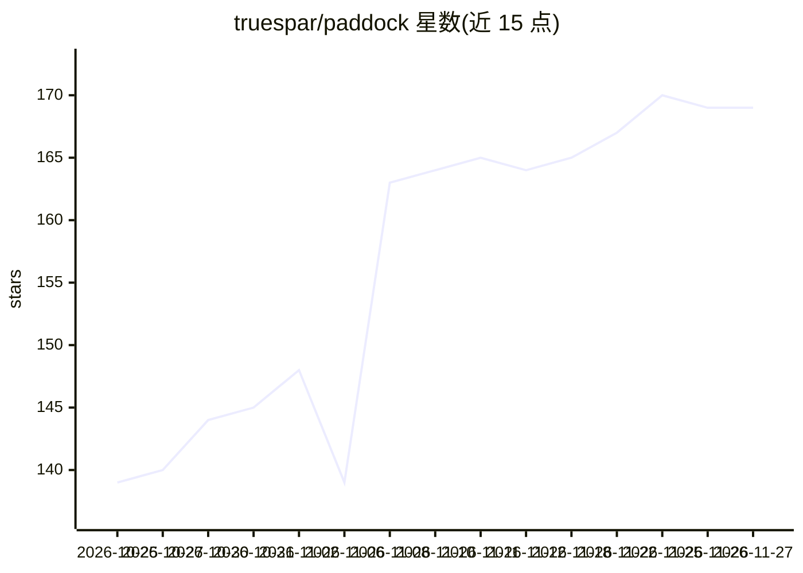

# truespar/paddock

⭐ 169 · Rust · NOASSERTION · 推送 2026-11-26 · [GitHub](https://github.com/truespar/paddock) · 组织维护

**为开发者和企业提供本地运行的开放模型推理服务器**

用 Rust 编写的模型推理服务器，原生实现调度器、分页 KV 缓存、内存管理与 CUDA/Metal 内核，提供 OpenAI 与 Anthropic 兼容 API，支持 GGUF 与 safetensors 权重及 FP8/NVFP4/MXFP4/Q8/Q4 等量化格式。面向需要在 NVIDIA GPU 与 Apple Silicon 上运行开放模型的组织，附带内置 Studio 网页界面用于下载、运行、对比模型，并支持通过 OpenRouter 与云端模型对比。macOS 原生应用为预发布状态。

## 筛选速览

| 维度 | 判定 | 备注 |
|---|---|---|
| AI 角色 | `ai-ecosystem` | LLM/agent 周边工具 |
| 许可风险 | `none` | NOASSERTION |
| 部署形态 | `desktop` | 安装包/桌面程序 |
| 模型依赖 | — | README 未给出锁定关系 |
| 硬件要求 | — | 无带数字的原话,不猜 |
| 安装摩擦 | `high` | 编译与系统依赖俱全 |
| 成熟度 | `idea` | |

## 能力要点

- 原生 Rust 推理引擎，CUDA 与 Metal 后端均在本仓库内实现
- OpenAI 与 Anthropic 兼容 API，含 embeddings、图像生成、语音转录、reranking 等接口
- 支持 GGUF 与 safetensors 格式及 FP8/NVFP4/MXFP4/Q8_0/Q4_K 等量化
- 内置 Studio 网页界面：模型管理、并排对比、决策/表格/掩码/嵌入页面

## 适用场景

- 在本地 NVIDIA GPU 上为生产环境部署开放模型
- 通过 OpenAI 兼容 API 服务编码 agent 的工作负载
- 在 Studio 中并排对比本地模型与云端模型
- 在 Apple Silicon Mac 上本地运行模型

## 场景标签

`推理引擎` · 领域:训练与推理

## 证据(README 行号)

> L11: AI inference server written in Rust, for NVIDIA GPUs and for Apple Silicon, with an OpenAI and
> L17: Two binaries, paddock-runner is what runs models and is really the only thing needed but we made
> L200: **APIs.** OpenAI chat completions, completions, the Responses API, embeddings,

## 星数曲线

2026-10-25 139 → 2026-11-27 169（+30）

---
*卡片 v1 · prompt 1.4 · 生成 2026-11-26 · 置信度 high · 依据 README sha `e4caa8a5d8cc` · [字段定义](../../DATASET.md)*
