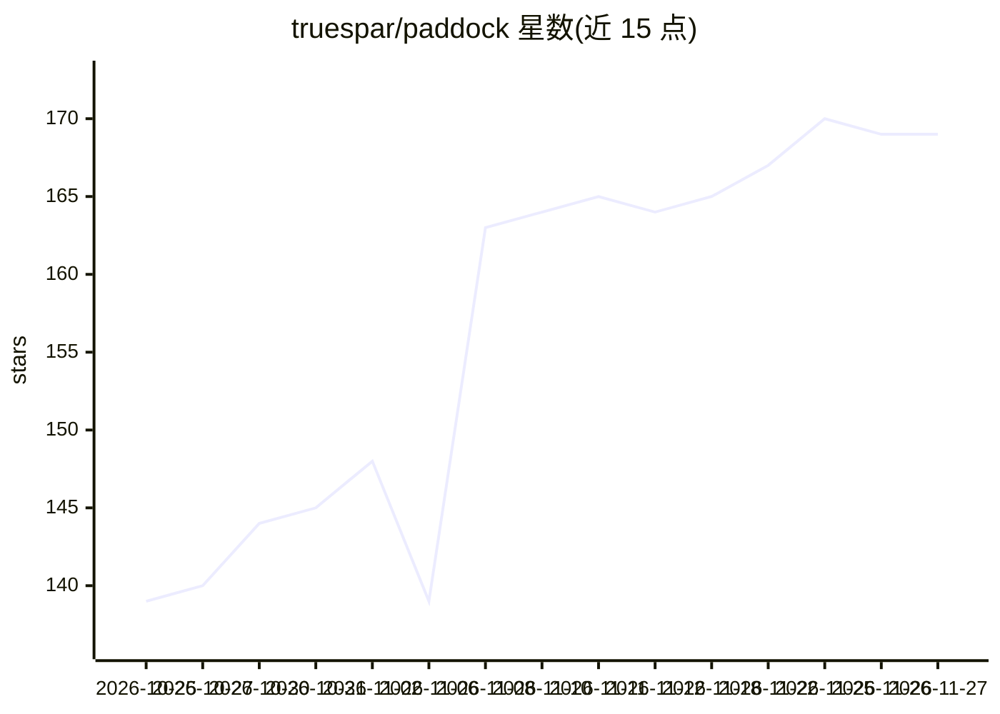

# truespar/paddock

⭐ 169 · Rust · NOASSERTION · 推送 2026-11-26 · [GitHub](https://github.com/truespar/paddock) · 组织维护

**面向 NVIDIA GPU 与 Apple Silicon 的 Rust 原生开源模型推理服务器**

用 Rust 编写的推理服务器，面向 NVIDIA GPU 与 Apple Silicon，提供 OpenAI 与 Anthropic 兼容 API 及内置 Studio 网页界面；作者声明调度器、分页 KV cache、CUDA/Metal 内核均在仓库内实现而非封装。支持 GGUF 与 safetensors 权重及多种量化格式，覆盖文本、视觉、图像生成、OCR、语音、嵌入、表格预测等模型。提供 dmg 原生桌面应用与命令行安装包，目标场景为在 Blackwell GPU 上生产运行开源模型；macOS 原生应用为预发布状态。

## 筛选速览

| 维度 | 判定 | 备注 |
|---|---|---|
| AI 角色 | `ai-ecosystem` | LLM/agent 周边工具 |
| 许可风险 | `none` | NOASSERTION |
| 部署形态 | `desktop` | 安装包/桌面程序 |
| 模型依赖 | — | README 未给出锁定关系 |
| 硬件要求 | — | 无带数字的原话,不猜 |
| 安装摩擦 | `high` | 编译与系统依赖俱全 |
| 成熟度 | `idea` | |

## 能力要点

- OpenAI/Anthropic 兼容 API，含 Realtime WebSocket、MCP 接口
- 原生实现 CUDA 与 Metal 后端，支持 FP8/NVFP4/MXFP4/Q8_0/Q4_K 等量化
- 内置 Studio：模型下载管理、并排对比本地与云端模型
- 支持 GGUF 与 safetensors，含 KV offload 与 MoE expert streaming

## 适用场景

- 在 RTX 5090/RTX PRO 6000/B200 上为生产环境部署开源模型
- 通过 OpenAI 兼容 API 为编码 agent 工作负载提供服务
- 在 Studio 中把本地模型与 OpenRouter 云模型并排对比
- 在 Apple Silicon Mac 上运行 MLX 量化模型

## 场景标签

`推理引擎` · 领域:训练与推理

## 证据(README 行号)

> L11: AI inference server written in Rust, for NVIDIA GPUs and for Apple Silicon, with an OpenAI and
> L14: It is a native engine and NOT A WRAPPER - the scheduler, the paged KV cache, the memory
> L204: **APIs.** OpenAI chat completions, completions, the Responses API, embeddings,

## 星数曲线

2026-10-25 139 → 2026-11-27 169（+30）

---
*卡片 v1 · prompt 1.4 · 生成 2026-11-27 · 置信度 high · 依据 README sha `dfaba331ff9e` · [字段定义](../../DATASET.md)*
