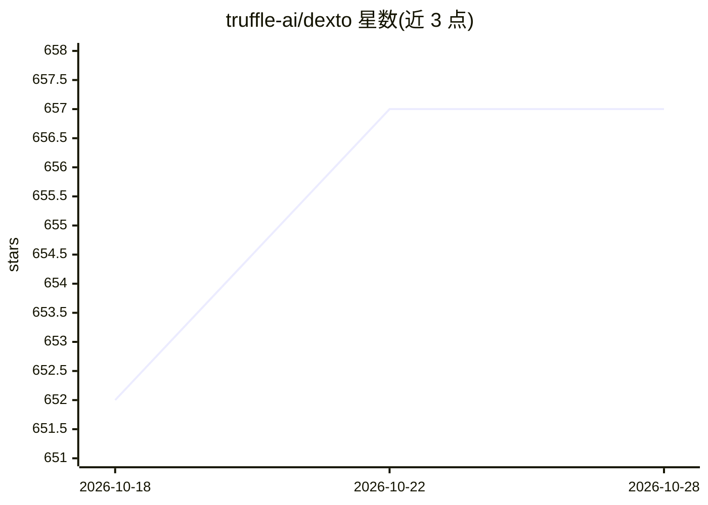

# truffle-ai/dexto

⭐ 657 · TypeScript · NOASSERTION · 推送 2026-10-23 · [GitHub](https://github.com/truffle-ai/dexto) · [官网](https://dexto.ai) · 组织维护 · 中文 README

**开源 AI agent 编排框架：把 LLM 变成可运行的有状态 agent**

TypeScript 编写的 agent harness，定位为 LLM 之上的编排层：通过 YAML 配置定义 agent，提供会话管理、工具编排、持久记忆、多模态与可观测性。内置可即用的 coding agent，支持 50+ LLM（OpenAI/Anthropic/Google/Groq/xAI 等）及本地 Ollama、GGUF（node-llama-cpp，自动 GPU 检测 Metal/CUDA/Vulkan）。集成 30+ MCP 工具，支持子 agent 生成、人机审批控制。运行形态覆盖 CLI、Web UI、REST/SSE 服务器与 MCP 服务器，并提供 npm SDK（@dexto/core）。收集匿名遥测数据。

## 筛选速览

| 维度 | 判定 | 备注 |
|---|---|---|
| AI 角色 | `ai-ecosystem` | LLM/agent 周边工具 |
| 许可风险 | `none` | NOASSERTION |
| 部署形态 | `library` | 以包/库形式分发 |
| 模型依赖 | local-ok | 支持本地模型 |
| 硬件要求 | — | 无带数字的原话,不猜 |
| 安装摩擦 | `medium` | 含编译或系统依赖之一 |
| 成熟度 | — | 结构信号不足 |

## 能力要点

- YAML 配置驱动定义 agent，免改代码切换模型与工具
- 支持 50+ LLM，含本地 Ollama 与 GGUF（自动 GPU 检测）
- 内置 coding agent 与 30+ MCP 工具集成，含 MCP Store
- 可作为 MCP 服务器供 Claude Code、Cursor 调用
- npm SDK @dexto/core 支持编程式构建 agent

## 适用场景

- 构建和运行自主编码、重构代码的 coding agent
- 通过 MCP 协议把 agent 接入 Cursor、Claude Code 等编辑器
- 搭建多 agent 协作系统（explore-agent、triage-agent 等）
- 以本地模型运行 agent 处理隐私数据

## 场景标签

`Agent 框架` `编码 Agent` `多智能体` · 领域:Agent 开发

## 证据(README 行号)

> L23: Dexto is an **agent harness**—the orchestration layer that turns LLMs into reliable, stateful agents that can take 
> L36: - **Configuration-driven**: Define agents in YAML. Swap models and tools without touching code.
> L50: Dexto ships with a **production-ready coding agent** you can use immediately via the CLI or Web UI.

## 星数曲线

2026-10-18 652 → 2026-10-28 657（+5）

---
*卡片 v1 · prompt 1.4 · 生成 2026-10-21 · 置信度 high · 依据 README sha `42a82da1ff10` · [字段定义](../../DATASET.md)*
