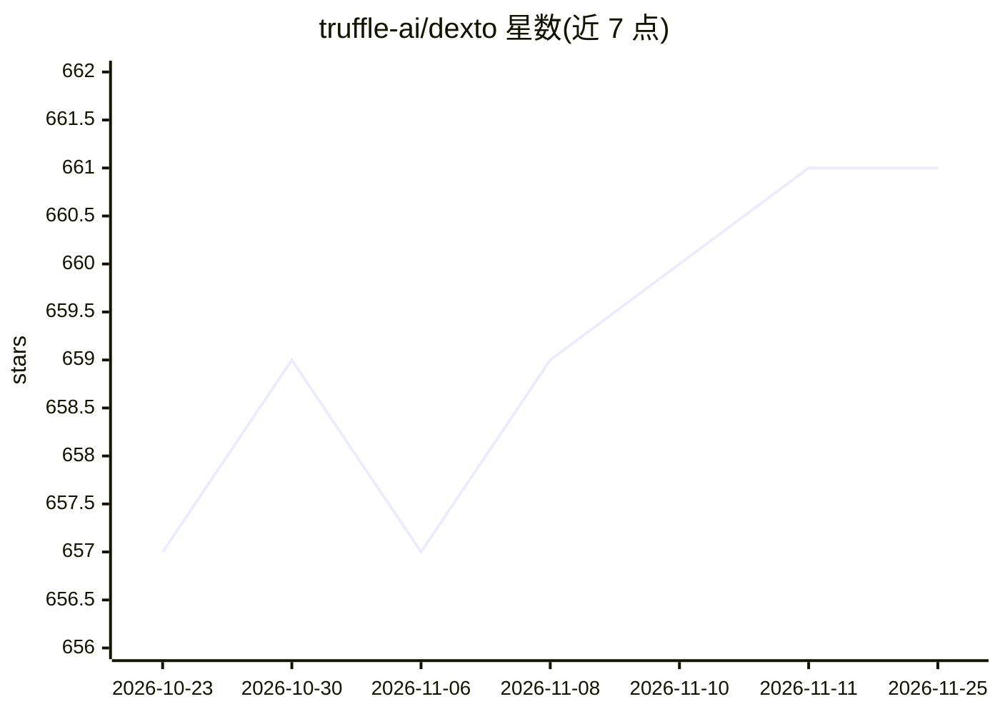

# truffle-ai/dexto

⭐ 661 · TypeScript · NOASSERTION · 推送 2026-11-24 · [GitHub](https://github.com/truffle-ai/dexto) · [官网](https://dexto.ai) · 组织维护

**开发者的 agent 编排框架：以 YAML 配置构建与运行 AI agent**

Dexto 定位为 agent harness，即把 LLM 编排为有状态 agent 的中间层，提供会话管理、工具编排、持久记忆、权限审批与多 agent 委派等机制。以 TypeScript 编写，通过 npm 提供 CLI 与 @dexto/core SDK，agent 用 YAML 配置定义，可在对话中切换模型。内置一个可直接使用的编码 agent，并支持通过 MCP 协议接入 30+ 工具服务器。安装需 Node.js 20+，模型调用需配置 API key 或积分；许可证为 Elastic License 2.0。

## 筛选速览

| 维度 | 判定 | 备注 |
|---|---|---|
| AI 角色 | `ai-ecosystem` | LLM/agent 周边工具 |
| 许可风险 | `none` | NOASSERTION |
| 部署形态 | `library` | 以包/库形式分发 |
| 模型依赖 | local-ok | 支持本地模型 |
| 硬件要求 | — | 无带数字的原话,不猜 |
| 安装摩擦 | `medium` | 含编译或系统依赖之一 |
| 成熟度 | — | 结构信号不足 |

## 能力要点

- YAML 配置驱动定义 agent，模型与工具可切换而无需改代码
- 支持 50+ LLM，内置 OpenAI/Anthropic/Google/Groq 等多个 provider 通道与本地模型
- MCP 集成连接 Puppeteer、Linear 等工具服务器，权限模式细粒度审批
- SDK 暴露 REST 与 SSE API，会话/存储后端可选 Redis/PostgreSQL/SQLite 等

## 适用场景

- 用 CLI 编码 agent 从自然语言生成和重构代码
- 在应用中嵌入 SDK 构建 own agent 后端
- 通过 MCP 接入文件、浏览器等工具构建自动化 agent
- 在终端中切换多个 LLM 进行会话式任务

## 场景标签

`Agent 框架` · 领域:Agent 开发

## 证据(README 行号)

> L47: Dexto is an **agent harness**—the orchestration layer that turns LLMs into reliable, stateful agents that can take 
> L220: ## Dexto Agents SDK
> L69: - **MCP Clients & Servers** – Connect tools, files, APIs via Model Context Protocol

## 星数曲线

2026-10-23 657 → 2026-11-25 661（+4）

---
*卡片 v1 · prompt 1.4 · 生成 2026-11-25 · 置信度 high · 依据 README sha `27f4160d6f89` · [字段定义](../../DATASET.md)*
