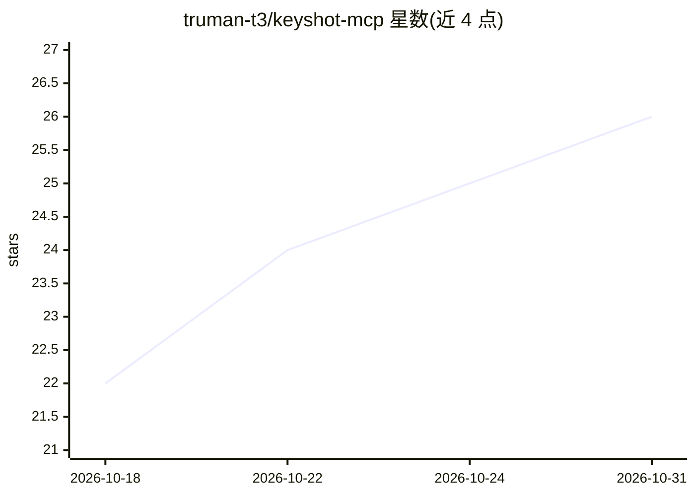

# truman-t3/keyshot-mcp

⭐ 26 · TypeScript · MIT · 推送 2026-10-28 · [GitHub](https://github.com/truman-t3/keyshot-mcp) · 个人维护 · 中文 README

**通过 AI Agent 控制本地 KeyShot 进行产品渲染的 MCP 服务器**

面向使用 KeyShot Studio 的工业/产品设计师的 TypeScript MCP 服务器，提供 19 个工具让 MCP 客户端中的 Agent 在本机以无头脚本方式检查已保存场景、调整材质/相机/环境、生成预览并渲染输出。工作流为：检查→修改场景副本→预览→确认后出图，不读取未保存的 GUI 会话。需要 Node.js 20+、MCP 兼容客户端与本地已授权且支持无头脚本的 KeyShot（Windows 11 + KeyShot 14.1 已测试，其他系统未验证）。输出路径与覆盖行为有安全限制。

## 筛选速览

| 维度 | 判定 | 备注 |
|---|---|---|
| AI 角色 | `ai-ecosystem` | LLM/agent 周边工具 |
| 许可风险 | `permissive` | MIT |
| 部署形态 | `desktop` | 安装包/桌面程序 |
| 模型依赖 | — | README 未给出锁定关系 |
| 硬件要求 | — | 无带数字的原话,不猜 |
| 安装摩擦 | `low` | 无编译、无系统依赖或容器化 |
| 成熟度 | — | 结构信号不足 |

## 能力要点

- 19 个 MCP 工具覆盖检查、材质、相机、环境与渲染
- 在场景副本上操作，预览确认后再出图，不覆盖原始场景
- 内置相机/材质预设 JSON，支持自定义
- 输出路径穿越与符号链接默认拒绝，写入默认不覆盖已有文件

## 适用场景

- 用自然语言让 Agent 调整 KeyShot 场景材质和相机并出图
- 批量渲染场景中所有相机或多个场景队列
- 导入模型、摆位、配置构图后保存 .bip 副本备渲染

## 场景标签

 · 领域:3D 渲染/工业设计工具

## 证据(README 行号)

> L3:  Product rendering in KeyShot, guided by your AI agent.
> L15:  19 MCP tools
> L33: > **Saved scenes, not realtime GUI control.** KeyShot MCP runs headless on the same

## 星数曲线

2026-10-18 22 → 2026-10-31 26（+4）

---
*卡片 v1 · prompt 1.4 · 生成 2026-10-26 · 置信度 high · 依据 README sha `6f8839ccb46c` · [字段定义](../../DATASET.md)*
