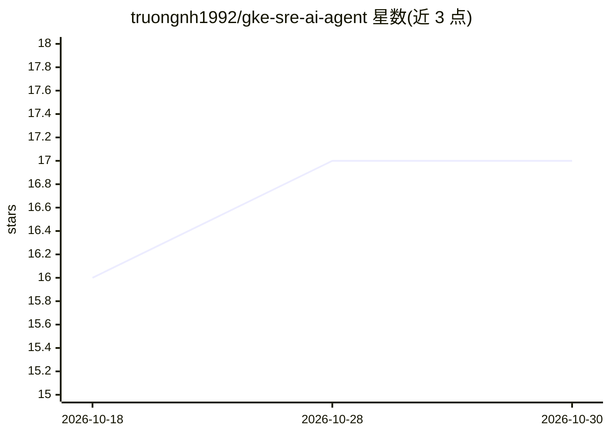

# truongnh1992/gke-sre-ai-agent

⭐ 17 · Python · MIT · 推送 2026-06-24 · [GitHub](https://github.com/truongnh1992/gke-sre-ai-agent) · 个人维护

**面向 GKE 的 AI 值班 SRE CLI：只读诊断并出具根因报告**

提供 gke-scout 命令行工具：指向异常工作负载后，由 Antigravity CLI（agy，Gemini 驱动）通过 GKE MCP server 与安全护栏代理开展只读调查，输出带证据引用的 Markdown 根因报告（含置信度、发现细节或假设列表）。护栏代理拦截所有变更类调用、脱敏 API 响应并审计全部工具调用日志。给运行 GKE 的运维/开发者使用，需预装 gcloud、kubectl、agy 与 uv。

## 筛选速览

| 维度 | 判定 | 备注 |
|---|---|---|
| AI 角色 | `ai-native` | 本体是模型或模型工具 |
| 许可风险 | `permissive` | MIT |
| 部署形态 | `library` | 以包/库形式分发 |
| 模型依赖 | — | README 未给出锁定关系 |
| 硬件要求 | — | 无带数字的原话,不猜 |
| 安装摩擦 | `low` | 无编译、无系统依赖或容器化 |
| 成熟度 | — | 结构信号不足 |

## 能力要点

- 只读调查，护栏代理拦截 apply/patch/delete/scale/exec 等变更调用
- 输出证据引用的根因报告，含 high/medium/low 置信度
- API 响应中脱敏 secrets 与敏感值，工具调用记录到审计日志
- gke-scout diagnose 每次运行前自动注册 MCP server 与技能

## 适用场景

- GKE 工作负载故障时让 AI 值班代理做只读排查
- 自动生成带证据引用的事故根因报告
- 在禁止 AI 修改集群的前提下引入 AI 辅助运维

## 场景标签

 · 领域:云原生运维/AIOps

## 证据(README 行号)

> L3: > Ships the **`gke-scout`** CLI — an AI on-call SRE for Google Kubernetes Engine.
> L7: hood it uses the Antigravity CLI (`agy`, powered by Gemini) talking to the
> L5: Point it at a broken workload; it investigates **read-only**, writes an

## 星数曲线

2026-10-18 16 → 2026-10-30 17（+1）

---
*卡片 v1 · prompt 1.4 · 生成 2026-10-29 · 置信度 high · 依据 README sha `4a2f03eee92b` · [字段定义](../../DATASET.md)*
