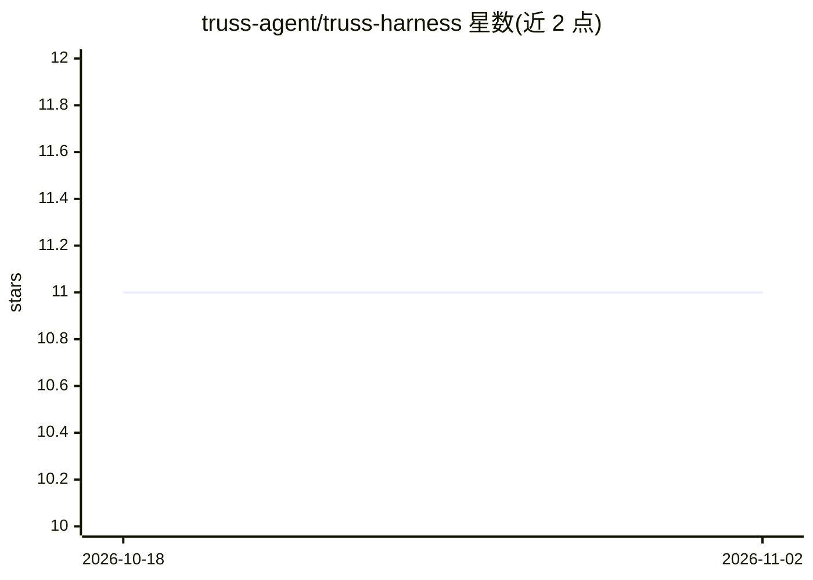

# truss-agent/truss-harness

⭐ 11 · TypeScript · NOASSERTION · 推送 2026-10-30 · [GitHub](https://github.com/truss-agent/truss-harness) · [官网](https://truss-agent.com) · 组织维护

**本地优先的编码 Agent 平台，跨 CLI/TUI/编辑器/桌面端运行**

面向开发者的本地优先、供应商中立的编码 Agent 平台：同一套模型、工具、权限与工作区记忆可通过 CLI、终端 TUI、Neovim 插件、VS Code 扩展、桌面应用与移动客户端访问。支持 Ollama、LM Studio、llama.cpp 等本地端点或自带 API key 的云供应商。机制上：多工作区本地受管 agent 档案、写入租约串行化 Edit agent、配置信任机制绑定工作区内容、三级权限审批与 MCP 服务器加载。许可为 source-available 而非 OSI 开源。CLI/TUI 需 Node.js 22.15.1+。

## 筛选速览

| 维度 | 判定 | 备注 |
|---|---|---|
| AI 角色 | `ai-ecosystem` | LLM/agent 周边工具 |
| 许可风险 | `none` | NOASSERTION |
| 部署形态 | `library` | 以包/库形式分发 |
| 模型依赖 | local-ok | 支持本地模型 |
| 硬件要求 | — | 无带数字的原话,不猜 |
| 安装摩擦 | `low` | 无编译、无系统依赖或容器化 |
| 成熟度 | — | 结构信号不足 |

## 能力要点

- 六种客户端（CLI/TUI/Neovim/VS Code/桌面/移动）共享同一工具与工作区状态
- 支持 Ollama、LM Studio、llama.cpp 等本地端点，无需托管控制面
- 配置信任与内容绑定凭据、工作区写入租约、三级工具审批
- 内置 Superpowers 技能包（MIT）并支持自定义技能与 MCP 服务器

## 适用场景

- 在终端或编辑器中用本地模型进行编码、计划与修改工作区
- 为不同任务配置不同模型/供应商的独立 agent 档案
- 通过手机客户端继续受信任的桌面会话

## 场景标签

`编码 Agent` · 领域:编码与开发

## 证据(README 行号)

> L5: Truss is a local-first, provider-neutral coding-agent platform. Use the same
> L14: Bring an Ollama, LM Studio, llama.cpp, or compatible endpoint—or configure a

## 星数曲线

2026-10-18 11 → 2026-11-02 11（+0）

---
*卡片 v1 · prompt 1.4 · 生成 2026-11-01 · 置信度 high · 依据 README sha `71a4cb0dab46` · [字段定义](../../DATASET.md)*
