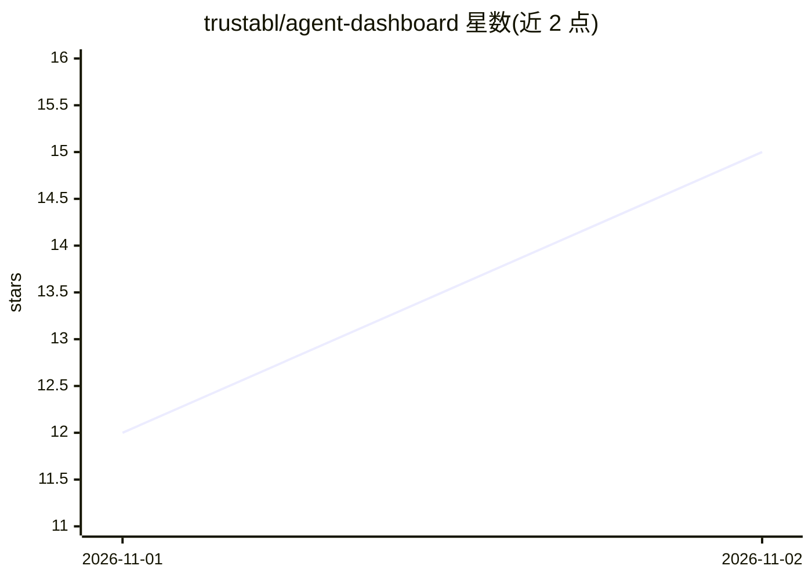

# trustabl/agent-dashboard

⭐ 15 · TypeScript · Apache-2.0 · 推送 2026-10-31 · [GitHub](https://github.com/trustabl/agent-dashboard) · [官网](https://www.trustabl.ai) · 组织维护

**本地单用户 Web UI：对自有仓库跑 agent 可靠性扫描与网络探测**

在 127.0.0.1 上运行的单用户本地 Web 控制台，封装 Trustabl 开源的 Analyzer、Forge 与 Probe 三个 CLI 工具（固定版本、SHA-256 校验后下载），提供仓库扫描、技能生成与网络访问探测，输出实时流式结果并保存 SARIF、SKILL.md 等工件。Probe 需要 Docker（或 OpenShell）与 OpenAI 兼容 LLM 端点（如 Ollama 本地模型），云端模型密钥从环境变量读取且不持久化。状态存于 ~/.agent-dashboard，可通过 make wipe 清除。

## 筛选速览

| 维度 | 判定 | 备注 |
|---|---|---|
| AI 角色 | `ai-ecosystem` | LLM/agent 周边工具 |
| 许可风险 | `permissive` | Apache-2.0 |
| 部署形态 | `None` |  |
| 模型依赖 | local-ok | 支持本地模型 |
| 硬件要求 | — | 无带数字的原话,不猜 |
| 安装摩擦 | `low` | 无编译、无系统依赖或容器化 |
| 成熟度 | — | 结构信号不足 |

## 能力要点

- 封装三个固定版本 CLI（SHA-256 校验），无需单独安装
- 仅监听 127.0.0.1，无登录与用户模型，源码留在本机
- Probe 支持本地 Ollama 模型或云端模型（密钥仅从环境变量读取）
- 每次运行提供 Copy CLI，可在终端复现相同命令

## 适用场景

- 对自己仓库跑 agent 可靠性扫描并查看发现结果
- 生成 agent 技能（SKILL.md）
- 对 agent 运行网络访问探测并用本地模型分析

## 场景标签

`代码审查` `网络安全` · 领域:编码与开发

## 证据(README 行号)

> L3: Agent dashboard runs reliability scans, skills and network access probes on your
> L11: |Forge|agent-reliability-analyzer|`trustabl forge`, `trustabl forge check`|

## 星数曲线

2026-11-01 12 → 2026-11-02 15（+3）

---
*卡片 v1 · prompt 1.4 · 生成 2026-10-31 · 置信度 high · 依据 README sha `54db25ac64be` · [字段定义](../../DATASET.md)*
