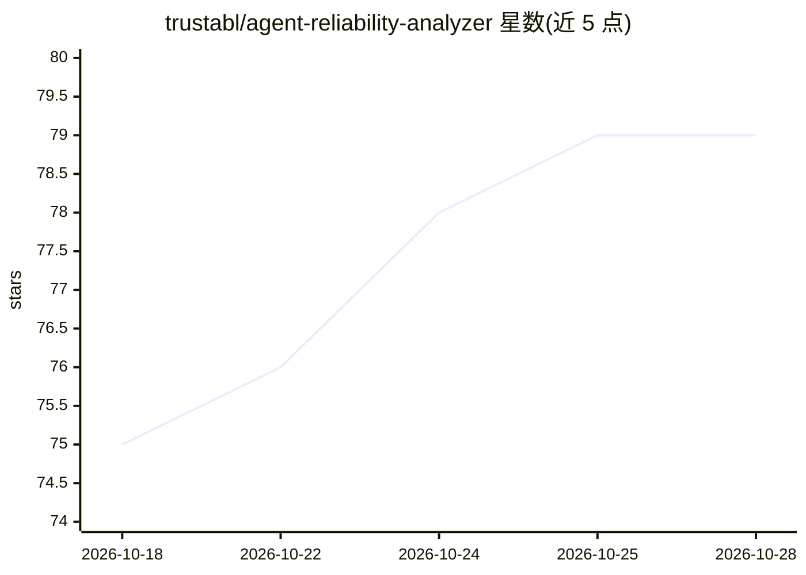

# trustabl/agent-reliability-analyzer

⭐ 79 · Go · Apache-2.0 · 推送 2026-10-26 · [GitHub](https://github.com/trustabl/agent-reliability-analyzer) · [官网](https://www.trustabl.ai/products/) · 组织维护

**AI agent 代码的本地静态扫描器：检出可靠性缺陷并自动生成修复**

面向 agent 开发者的确定性静态分析工具：扫描本地或 GitHub 上的 agent 仓库，按 tool/agent/subagent/skill/repo 五个作用域检测工具描述模糊、缺超时与重试、无类型参数、缺护栏、权限越界等问题，每条发现附带修复，可用 trustabl enrich --apply 写回源码。支持 9 种 SDK、7 种语言，输出 human/JSON/SARIF 格式，退出码可作 CI 门禁。扫描全程本地运行、无需 LLM 与密钥；应用修复时使用用户自己的 Anthropic/OpenAI/Google key。规则从独立 git 仓库解析，与二进制发布解耦。分发渠道包括 npm/PyPI/Homebrew/Scoop/Docker/二进制、VS Code/Cursor/MCP 集成及多家 CI 目录。

## 筛选速览

| 维度 | 判定 | 备注 |
|---|---|---|
| AI 角色 | `ai-ecosystem` | LLM/agent 周边工具 |
| 许可风险 | `permissive` | Apache-2.0 |
| 部署形态 | `desktop` | 安装包/桌面程序 |
| 模型依赖 | — | README 未给出锁定关系 |
| 硬件要求 | — | 无带数字的原话,不猜 |
| 安装摩擦 | `low` | 无编译、无系统依赖或容器化 |
| 成熟度 | — | 结构信号不足 |

## 能力要点

- 五作用域检测模型，发现按具体 tool/agent/subagent 定位并附带修复
- 确定性静态分析：本地运行，无需云服务、账号或 LLM
- 支持 9 种 agent SDK（Claude Agent SDK/OpenAI Agents SDK/Google ADK 等）与 7 种语言
- 规则库与二进制解耦，从独立 git 仓库拉取并缓存，ScanID 记录所用规则版本

## 适用场景

- 上线前扫描 agent 仓库找出导致生产失败的代码缺陷
- 在 CI 中按严重度阈值拦截不合格的 agent 构建
- 自动将修复补丁应用到工具定义与护栏缺失处

## 场景标签

`代码审查` · 领域:编码与开发

## 证据(README 行号)

> L20: Deterministic static analysis for agent code, across nine SDKs and seven languages.
> L59: Trustabl scans an agent repository for the gaps that break agents in production:

## 星数曲线

2026-10-18 75 → 2026-10-28 79（+4）

---
*卡片 v1 · prompt 1.4 · 生成 2026-10-24 · 置信度 high · 依据 README sha `bb209fb9a5e4` · [字段定义](../../DATASET.md)*
