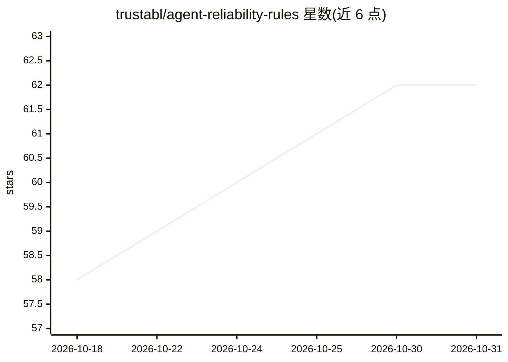

# trustabl/agent-reliability-rules

⭐ 62 · Python · Apache-2.0 · 推送 2026-10-29 · [GitHub](https://github.com/trustabl/agent-reliability-rules) · 组织维护

**AI agent SDK 可靠性/安全检测规则包，供 Trustabl 扫描器调用**

存放确定性检测规则的仓库（Apache-2.0），引擎不在二进制中内置规则，而是在每次扫描时从本仓库解析规则（本地缓存、可离线、可固定 tag）。规则按 10 个包组织：Claude Agent SDK、Claude skills、OpenAI Agents SDK、Google ADK、MCP servers、LangChain/LangGraph、CrewAI、AutoGen、Pydantic AI、Vercel AI SDK，覆盖 tool/agent/subagent/skill/repo 五个作用域。每个 .yaml 定义一条或多条规则，manifest.yaml 声明 schema_version 做兼容门控。规则谓词与 schema 实现位于引擎仓库，本仓库不含可执行代码。

## 筛选速览

| 维度 | 判定 | 备注 |
|---|---|---|
| AI 角色 | `ai-ecosystem` | LLM/agent 周边工具 |
| 许可风险 | `permissive` | Apache-2.0 |
| 部署形态 | `None` |  |
| 模型依赖 | — | README 未给出锁定关系 |
| 硬件要求 | — | 无带数字的原话,不猜 |
| 安装摩擦 | `low` | 无编译、无系统依赖或容器化 |
| 成熟度 | — | 结构信号不足 |

## 能力要点

- 10 个 agent SDK/框架专用检测规则包
- 引擎扫描时动态拉取规则（缓存/离线/固定版本）
- manifest.yaml 的 schema_version 门控防止新旧不匹配
- 规则 ID 前缀区分 SDK，编号区分 tool/agent/repo 作用域

## 适用场景

- 为 Trustabl 扫描器提供 agent 代码的可靠性与安全检测规则
- 为特定 agent SDK（如 Claude、OpenAI Agents、CrewAI）编写或查找检测规则
- 审计扫描结果对应的规则包版本（ScanID 记录 commit SHA）

## 场景标签

`网络安全` · 领域:学习与行业

## 证据(README 行号)

> L18: open-source tool for AI agent reliability — it finds and fixes reliability,
> L19: safety, and security defects in agent code. The engine resolves them from this
> L12: Ten packs: Claude Agent SDK, Claude skills, OpenAI Agents SDK, Google ADK, MCP

## 星数曲线

2026-10-18 58 → 2026-10-31 62（+4）

---
*卡片 v1 · prompt 1.4 · 生成 2026-10-24 · 置信度 high · 依据 README sha `6c712de996ab` · [字段定义](../../DATASET.md)*
