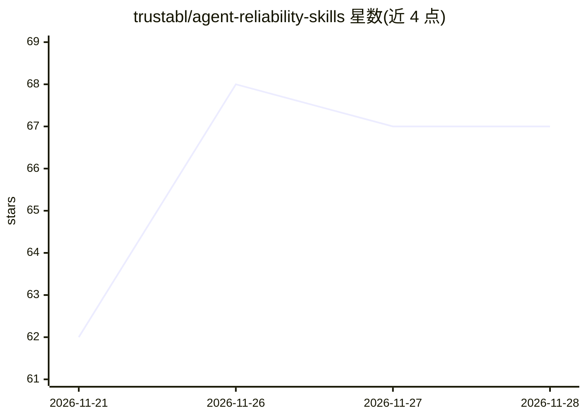

# trustabl/agent-reliability-skills

⭐ 67 · JavaScript · Apache-2.0 · 推送 2026-11-24 · [GitHub](https://github.com/trustabl/agent-reliability-skills) · 组织维护

**为 agent 仓库生成编码前可靠性 skill 的 MCP 服务器**

Trustabl Forge 的 MCP 服务器：读取仓库的依赖清单（package.json、pyproject.toml、requirements.txt、go.mod 等），识别所使用的 agent SDK，按 Trustabl 检测规则为这些 SDK 生成仓库专属的 SKILL.md，agent 在写代码时即应用规则而非事后扫描发现。支持 Claude Agent SDK、OpenAI Agents SDK、Google ADK、MCP、LangChain/LangGraph、CrewAI、Pydantic AI、Vercel AI SDK、AutoGen。需 Node.js 22+，首次调用需联网下载分析器二进制并校验 checksum，之后可离线缓存运行。

## 筛选速览

| 维度 | 判定 | 备注 |
|---|---|---|
| AI 角色 | `ai-ecosystem` | LLM/agent 周边工具 |
| 许可风险 | `permissive` | Apache-2.0 |
| 部署形态 | `library` | 以包/库形式分发 |
| 模型依赖 | — | README 未给出锁定关系 |
| 硬件要求 | — | 无带数字的原话,不猜 |
| 安装摩擦 | `low` | 无编译、无系统依赖或容器化 |
| 成熟度 | — | 结构信号不足 |

## 能力要点

- 按仓库依赖清单检测 SDK 并生成对应的 SKILL.md
- 提供 MCP 服务器、Claude Code 插件、PyPI、CLI、Homebrew/Scoop/Docker 等多种入口
- 下载的分析器二进制经 checksums.txt 校验，不匹配即失败
- 仅在给定 output_path 时写文件，且不覆盖手写文件

## 适用场景

- 为使用 LangChain/CrewAI 等框架的 agent 仓库生成编码前可靠性规则
- 在 Claude Code 或 Cursor 中以 MCP 方式按需生成 skill
- CI 中以固定版本的分析器二进制离线复现 skill 生成

## 场景标签

`代码生成` · 领域:编码与开发

## 证据(README 行号)

> L5: Agent Reliability Skills is the MCP server for Trustabl Forge. It writes a pre-coding reliability skill for **your**
> L8: exactly those SDKs. An agent that reads the skill applies the rules while it writes code, instead of meeting them

## 星数曲线

2026-11-21 62 → 2026-11-28 67（+5）

---
*卡片 v1 · prompt 1.4 · 生成 2026-11-21 · 置信度 high · 依据 README sha `a2c2f31b53b3` · [字段定义](../../DATASET.md)*
