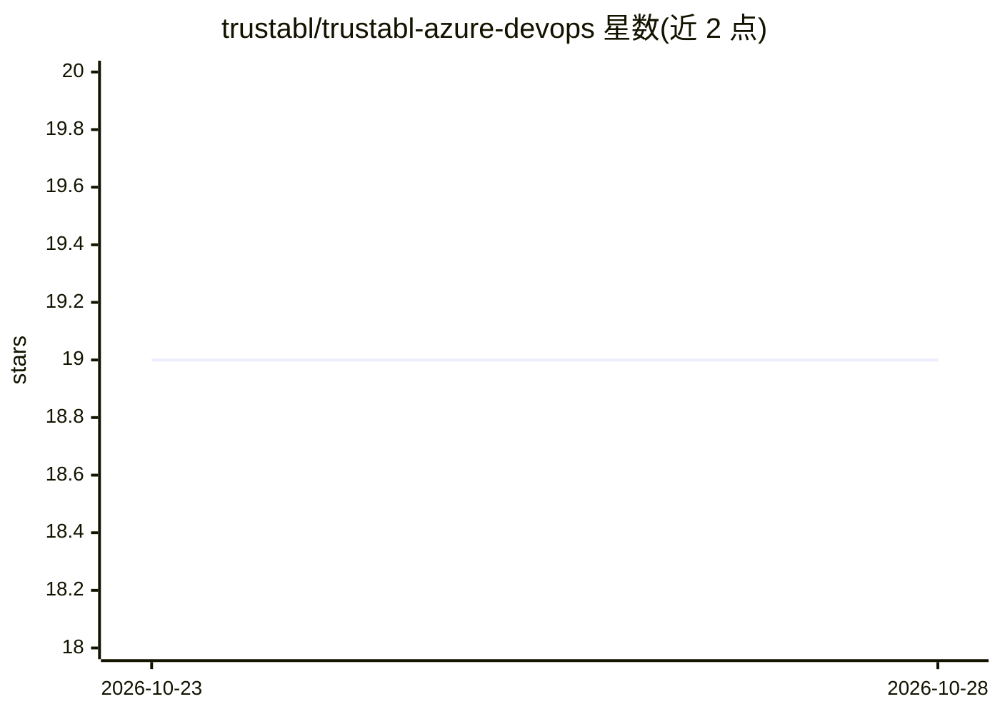

# trustabl/trustabl-azure-devops

⭐ 19 · TypeScript · NOASSERTION · 推送 2026-10-22 · [GitHub](https://github.com/trustabl/trustabl-azure-devops) · 组织维护

**在 Azure Pipelines 中扫描 AI agent 代码库可靠性的扩展任务**

Azure DevOps 流水线任务，封装专有工具 trustabl：下载其官方发布二进制（Linux/Windows/macOS），扫描源码中的工具、agent、子 agent 与 MCP 服务器，计算 readiness/risk 分数，可按风险分或严重级阈值使构建失败，并发布 trustabl.json/SARIF 构建产物与输出变量。可选 AI enrichment（BYOK，目前仅支持 Anthropic）为发现生成解释与修复建议。面向使用 Azure Pipelines 的 AI agent 开发团队；源码许可为仅限使用，禁止复制与再分发。

## 筛选速览

| 维度 | 判定 | 备注 |
|---|---|---|
| AI 角色 | `ai-ecosystem` | LLM/agent 周边工具 |
| 许可风险 | `none` | NOASSERTION |
| 部署形态 | `library` | 以包/库形式分发 |
| 模型依赖 | locked-api |  |
| 硬件要求 | — | 无带数字的原话,不猜 |
| 安装摩擦 | `low` | 无编译、无系统依赖或容器化 |
| 成熟度 | — | 结构信号不足 |

## 能力要点

- 扫描 Claude Agent SDK、OpenAI Agents SDK、Google ADK、LangChain、CrewAI、AutoGen、MCP 等 agent 代码库
- readiness/risk 评分与按阈值使流水线失败的门禁机制
- 发布 trustabl.json、SARIF 产物与可消费的输出变量
- 可选 AI enrichment（BYOK，Anthropic）生成解释与修复建议

## 适用场景

- 在 CI 流水线中对 AI agent 代码做可靠性门禁
- 获取 agent 项目的就绪度/风险分数用于质量追踪
- 为扫描发现生成自然语言解释与修复建议

## 场景标签

 · 领域:AI agent 可靠性/CI 工具

## 证据(README 行号)

> L3: An Azure Pipelines task that runs trustabl,
> L5: Agents SDK, Google ADK, LangChain, LangGraph, CrewAI, AutoGen, AG2, Pydantic AI,
> L25: - Scans your sources for tools, agents, subagents, and MCP servers.

## 星数曲线

2026-10-23 19 → 2026-10-28 19（+0）

---
*卡片 v1 · prompt 1.4 · 生成 2026-10-28 · 置信度 high · 依据 README sha `fdc4a41af779` · [字段定义](../../DATASET.md)*
