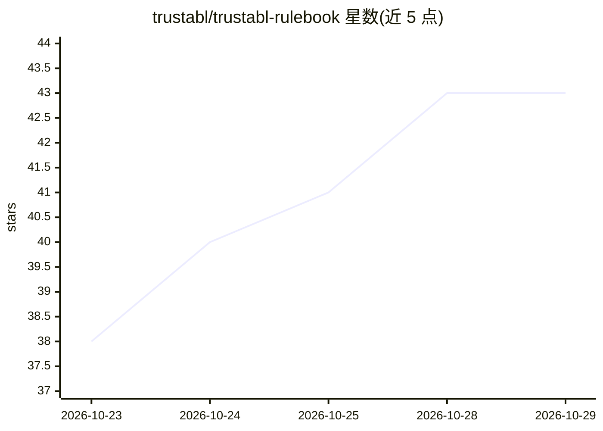

# trustabl/trustabl-rulebook

⭐ 43 · Python · GPL-3.0 · 推送 2026-10-28 · [GitHub](https://github.com/trustabl/trustabl-rulebook) · 组织维护

**Agent 可靠性静态分析规则的索引与威胁模型说明文档库**

trustabl Agent Reliability Analyzer 的规则说明书仓库：本身不含规则 YAML，仅为权威规则包 trustabl/agent-reliability-rules 中的每条规则提供索引与配套文档（威胁模型、检测方式、参考文献），覆盖 Claude Agent SDK、OpenAI Agents SDK、Google ADK、LangChain/LangGraph、CrewAI、AutoGen/AG2、Vercel AI SDK、Pydantic AI 八个框架及 MCP、Claude Skills 两个规则族。索引由 tools/gen_index.py 生成并在 CI 中校验，rationale 覆盖由 --strict 脚本强制。面向需要理解规则为何触发的分析引擎用户与规则贡献者，文档库不被引擎读取。

## 筛选速览

| 维度 | 判定 | 备注 |
|---|---|---|
| AI 角色 | `ai-knowledge` | 知识聚合/清单类 |
| 许可风险 | `viral` | GPL-3.0 |
| 部署形态 | `None` |  |
| 模型依赖 | — | README 未给出锁定关系 |
| 硬件要求 | — | 无带数字的原话,不猜 |
| 安装摩擦 | `low` | 无编译、无系统依赖或容器化 |
| 成熟度 | — | 结构信号不足 |

## 能力要点

- 覆盖 8 个 agent 框架与 MCP、Claude Skills 共 10 个规则族
- POLICY_INDEX.md 索引由脚本生成并在 CI 中用 --check 校验
- check_rulebook.py --strict 强制每条已发布规则配有 rationale 文档
- 风险分 = severity_weight × confidence × 100，权重分级明示

## 适用场景

- 查某条规则为何触发的威胁模型与参考文献
- 为新规则撰写 rationale 文档并按贡献流程提交
- 了解分析器在各框架下的规则覆盖范围

## 场景标签

 · 领域:Agent 安全/静态分析文档

## 证据(README 行号)

> L3: Index and rationale docs for the trustabl
> L63: This repo is **documentation only** — it contains no rule YAML and the trustabl

## 星数曲线

2026-10-23 38 → 2026-10-29 43（+5）

---
*卡片 v1 · prompt 1.4 · 生成 2026-10-25 · 置信度 high · 依据 README sha `4fdc3ed6119c` · [字段定义](../../DATASET.md)*
