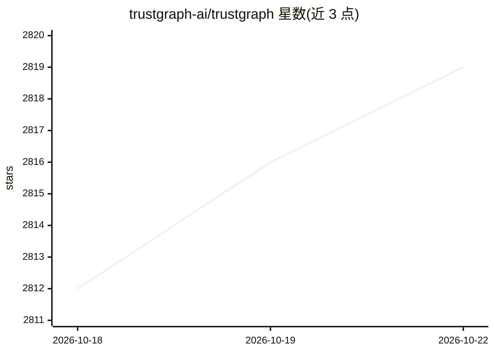

# trustgraph-ai/trustgraph

⭐ 2,823 · Python · Apache-2.0 · 推送 2026-10-21 · [GitHub](https://github.com/trustgraph-ai/trustgraph) · [官网](https://TrustGraph.ai) · 组织维护

**企业级语义 Agent 治理平台：本体化的操作图与策略运行时**

TrustGraph 将企业知识、系统与业务逻辑构建为基于 W3C RDF 1.2/OWL 的操作图，配合策略运行时在 Agent 执行动作前校验权限、范围与证据，并以 PROV-O 溯源记录每次决策。提供非结构化数据摄取（PDF/DOCX/HTML 等）、SPARQL 与 GraphRAG 查询、自带 Agent Runtime 与 API Gateway、以及覆盖主流 LLM API 与开源自托管（vLLM/TGI/Ollama 等）的推理栈。以 Docker 容器集合部署，通过 npx 命令行一步配置，提供 Web UI 与 TypeScript 客户端库。

## 筛选速览

| 维度 | 判定 | 备注 |
|---|---|---|
| AI 角色 | `ai-ecosystem` | LLM/agent 周边工具 |
| 许可风险 | `permissive` | Apache-2.0 |
| 部署形态 | `self-host` | docker 或自建部署 |
| 模型依赖 | local-ok | 支持本地模型 |
| 硬件要求 | — | 无带数字的原话,不猜 |
| 安装摩擦 | `low` | 无编译、无系统依赖或容器化 |
| 成熟度 | — | 结构信号不足 |

## 能力要点

- 基于 RDF 1.2/OWL/SHACL/PROV-O 的本体驱动操作图
- Agent 动作执行前的策略校验与可查询溯源
- 集成 vLLM/TGI/Ollama 等的开源模型推理栈，可不依赖第三方 API key
- Web UI 含 Agent Console、GraphRAG View、本体编辑器等工具

## 适用场景

- 为企业 AI Agent 提供受策略治理的知识与行动平台
- 把文档与业务数据转成带溯源的语义知识图供 Agent 检索
- 自托管部署需可解释、可审计 Agent 决策的 LLM 应用

## 场景标签

`知识图谱` `RAG` `Agent 框架` · 领域:Agent 开发

## 证据(README 行号)

> L13: TrustGraph turns enterprise knowledge, systems, and business logic into an ontology-grounded operating graph connec
> L65: - **Agent Runtime** — Bring your own agent framework and integrate via the TrustGraph API Gateway, or use the nativ
> L69: - **Full LLM Inference Stack** — Connect to all major LLM provider APIs, or self-host open-weight models on Nvidia,

## 星数曲线

2026-10-18 2,812 → 2026-10-22 2,819（+7）

---
*卡片 v1 · prompt 1.4 · 生成 2026-10-21 · 置信度 mid · 依据 README sha `24da55ee28b1` · [字段定义](../../DATASET.md)*
