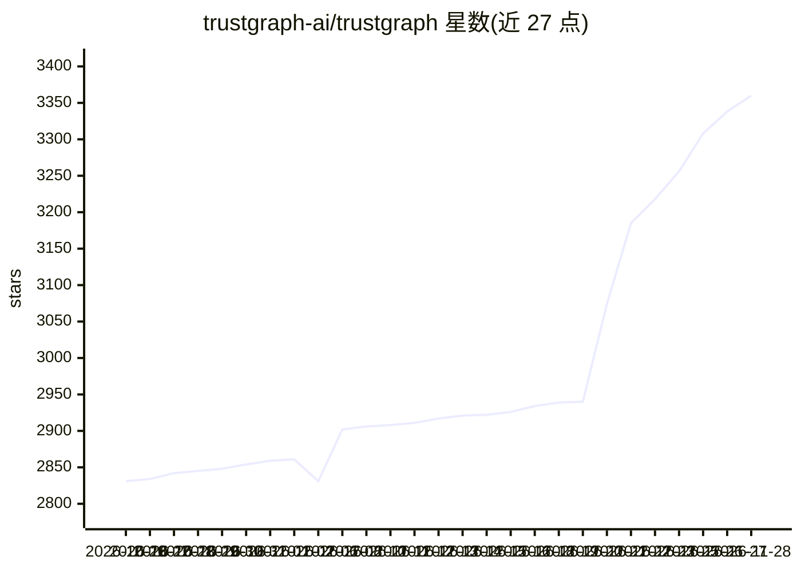

# trustgraph-ai/trustgraph

⭐ 3,360 · Python · Apache-2.0 · 推送 2026-11-27 · [GitHub](https://github.com/trustgraph-ai/trustgraph) · [官网](https://TrustGraph.ai) · 组织维护

**面向 AI agent 的开源本体运行时与知识治理平台**

TrustGraph 将文档与结构化数据转为基于本体的知识图谱，运行 Docker/Podman/Kubernetes 部署的一组容器。核心机制包括：OntologyRAG 用本体引导三元组抽取并按约束校验、SHACL-AF 策略对每条查询做节点级过滤、PROV-O 溯源与推理轨迹、GraphRAG/DocumentRAG 检索，以及 ReAct 等 agent 编排与 MCP server。知识以 W3C 标准（RDF/OWL/SPARQL）存储，可打包为 Context Cores 迁移。README 注明它不是完整 OWL 推理器。

## 筛选速览

| 维度 | 判定 | 备注 |
|---|---|---|
| AI 角色 | `ai-ecosystem` | LLM/agent 周边工具 |
| 许可风险 | `permissive` | Apache-2.0 |
| 部署形态 | `self-host` | docker 或自建部署 |
| 模型依赖 | local-ok | 支持本地模型 |
| 硬件要求 | — | 无带数字的原话,不猜 |
| 安装摩擦 | `low` | 无编译、无系统依赖或容器化 |
| 成熟度 | — | 结构信号不足 |

## 能力要点

- 基于 W3C 标准（RDF、OWL、SHACL、PROV-O）存储本体与溯源，支持 Turtle/TriG 导入导出
- SHACL-AF 策略对 REST API、SPARQL、GraphRAG 查询做三态（Allowed/Filtered/Violation）过滤并发布审计事件
- OntologyRAG 以本体引导抽取并校验 domain/range 与子类约束；另提供 GraphRAG 与混合检索
- MCP server 与 ReAct、Plan-then-Execute、Supervisor 三种 agent 编排模式

## 适用场景

- 企业需要把文档与数据沉淀为本体约束的知识图谱供 agent 查询
- 对 agent 回答做节点级访问控制与可查询的审计溯源
- 在自有云或本地环境运行知识图谱服务，避免绑定单一平台
- 通过 MCP 或 SPARQL 将知识图谱接入现有 agent 流程

## 场景标签

`知识图谱` `RAG` `文档解析` · 领域:知识与检索

## 证据(README 行号)

> L7: ### The open-source ontology runtime for AI agents
> L73: - **MCP server** with tools for graph queries, SPARQL, GraphQL over structured data and embeddings, with bearer-tok

## 星数曲线

2026-10-26 2,831 → 2026-11-28 3,360（+529）

---
*卡片 v1 · prompt 1.4 · 生成 2026-11-23 · 置信度 mid · 依据 README sha `ab6b5531884a` · [字段定义](../../DATASET.md)*
