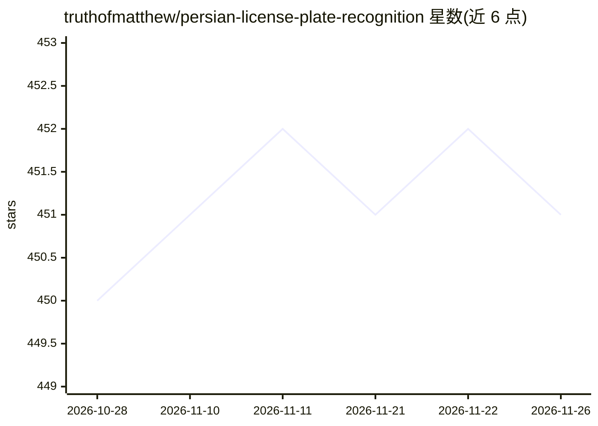

# truthofmatthew/persian-license-plate-recognition

⭐ 451 · Python · GPL-3.0 · 推送 2026-10-28 · [GitHub](https://github.com/truthofmatthew/persian-license-plate-recognition) · 个人维护

**从摄像头/视频/照片读取伊朗车牌并判断车辆准入**

基于 YOLOv5s 车牌检测器与 43 类字符检测器（ONNX Runtime，运行时无需 PyTorch）的波斯车牌识别系统，附带车牌语法校验与跨帧投票跟踪，使一辆车产生一条记录。同一套模型以四种形态运行：WebGPU/WebAssembly 浏览器应用（数据留存本地 IndexedDB）、PySide6 桌面应用、FastAPI 服务器（住户管理、通行记录、审核队列、签名 webhook）以及读取 RTSP 流的边缘 agent，另有 Docker 编排与 INT8 量化、合成数据生成、训练导出脚本。特殊牌照（出租车、警车等）在重训前识别效果差，仓库仅附带两张真实标注车牌。

## 筛选速览

| 维度 | 判定 | 备注 |
|---|---|---|
| AI 角色 | `ai-native` | 本体是模型或模型工具 |
| 许可风险 | `viral` | GPL-3.0 |
| 部署形态 | `library` | 以包/库形式分发 |
| 模型依赖 | — | README 未给出锁定关系 |
| 硬件要求 | — | 无带数字的原话,不猜 |
| 安装摩擦 | `low` | 无编译、无系统依赖或容器化 |
| 成熟度 | — | 结构信号不足 |

## 能力要点

- 浏览器端推理：WebGPU 或 WebAssembly，可离线安装，无需上传数据
- 跨帧投票跟踪器使每辆车仅生成一条通行记录
- FastAPI 服务器提供角色 API key、签名 webhook 与数据保留策略
- 边缘 agent 支持离线缓冲，并可联动道闸继电器

## 适用场景

- 小区/单位门禁读牌并自动判断住户车辆放行
- 在浏览器中直接识别车牌照片或视频
- 通过 RTSP 摄像头在网关旁部署边缘识别 agent

## 场景标签

`目标检测` `OCR` · 领域:感知与多模态

## 证据(README 行号)

> L3: Read Iranian license plates from a camera, a video or a photo, and decide whether the car may enter.
> L4: Version 2 runs the same models in four places: a browser tab, the original desktop app, an API server, and an edge a
> L21: |Core library|`plpr/`|ONNX Runtime engine (no PyTorch), Persian plate grammar, tracker that votes across frames so 

## 星数曲线

2026-10-28 450 → 2026-11-26 451（+1）

---
*卡片 v1 · prompt 1.4 · 生成 2026-11-25 · 置信度 high · 依据 README sha `f5ba23a2d34a` · [字段定义](../../DATASET.md)*
