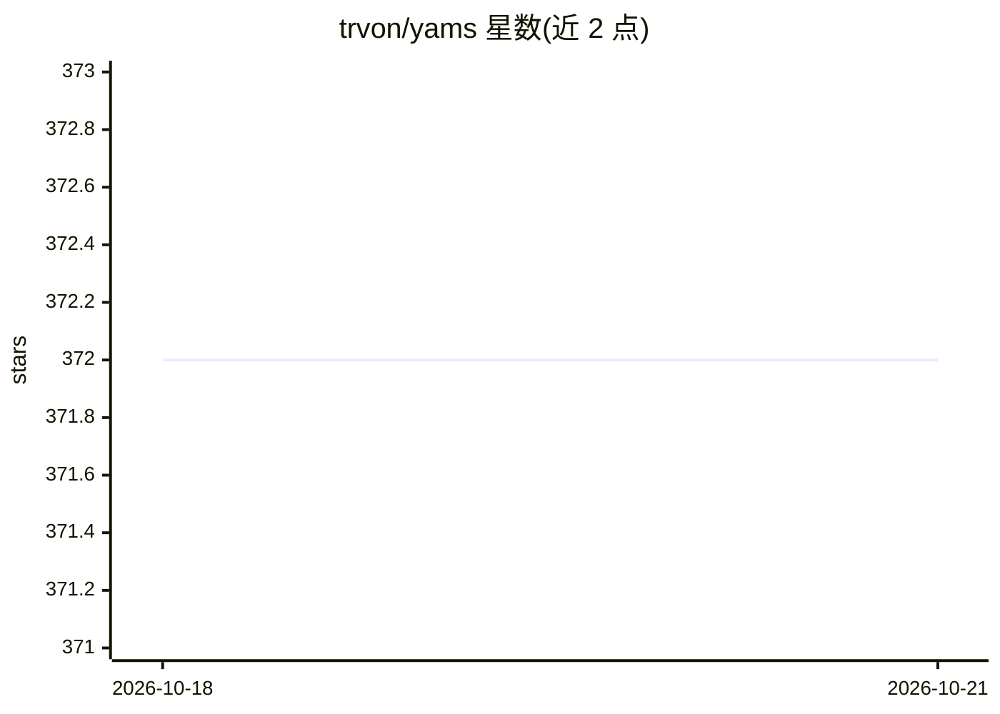

# trvon/yams

⭐ 372 · C++ · GPL-3.0 · 推送 2026-10-22 · [GitHub](https://github.com/trvon/yams) · [官网](https://yamsmemory.ai/) · 个人维护

**面向 LLM 与本地应用的持久化内容寻址记忆存储**

YAMS 是运行在本机的持久化可检索记忆系统：以 SHA-256 内容寻址存储代码与文档，提供块级去重与压缩，通过 SQLite FTS5 全文、Simeon 嵌入、混合搜索与知识图谱四种方式检索。数据保存在用户自选目录，无需账号或托管服务。提供 CLI、stdio 上的 MCP 服务器与 C ABI（供插件和移动宿主使用），支持快照、Merkle 树 diff 与损坏检测修复工具。自声明 pre-1.0 实验阶段，可能有 bug 与破坏性变更。macOS 提供 brew 安装，另有 Fedora/Arch/Windows MSI 等途径。

## 筛选速览

| 维度 | 判定 | 备注 |
|---|---|---|
| AI 角色 | `ai-ecosystem` | LLM/agent 周边工具 |
| 许可风险 | `viral` | GPL-3.0 |
| 部署形态 | `None` |  |
| 模型依赖 | — | README 未给出锁定关系 |
| 硬件要求 | — | 无带数字的原话,不猜 |
| 安装摩擦 | `low` | 无编译、无系统依赖或容器化 |
| 成熟度 | `idea` | |

## 能力要点

- SHA-256 内容寻址存储，块级去重与压缩
- 全文、向量、混合搜索与知识图谱检索
- CLI、MCP 服务器（stdio）与 C ABI 三种接入方式
- 快照、Merkle 树 diff、损坏检测与修复工具

## 适用场景

- 为本地 LLM 工具链提供可检索的长期记忆库
- 通过 MCP 向兼容开发工具暴露本地语料库
- 管理代码与文档语料并追踪版本与损坏情况

## 场景标签

 · 领域:LLM 基础设施/本地存储

## 证据(README 行号)

> L3: Persistent, searchable memory for code, documents, and local applications.
> L25: - A CLI, an MCP server over stdio, and a C ABI for plugins and mobile hosts

## 星数曲线

2026-10-18 372 → 2026-10-21 372（+0）

---
*卡片 v1 · prompt 1.4 · 生成 2026-10-22 · 置信度 high · 依据 README sha `3049299ffba5` · [字段定义](../../DATASET.md)*
