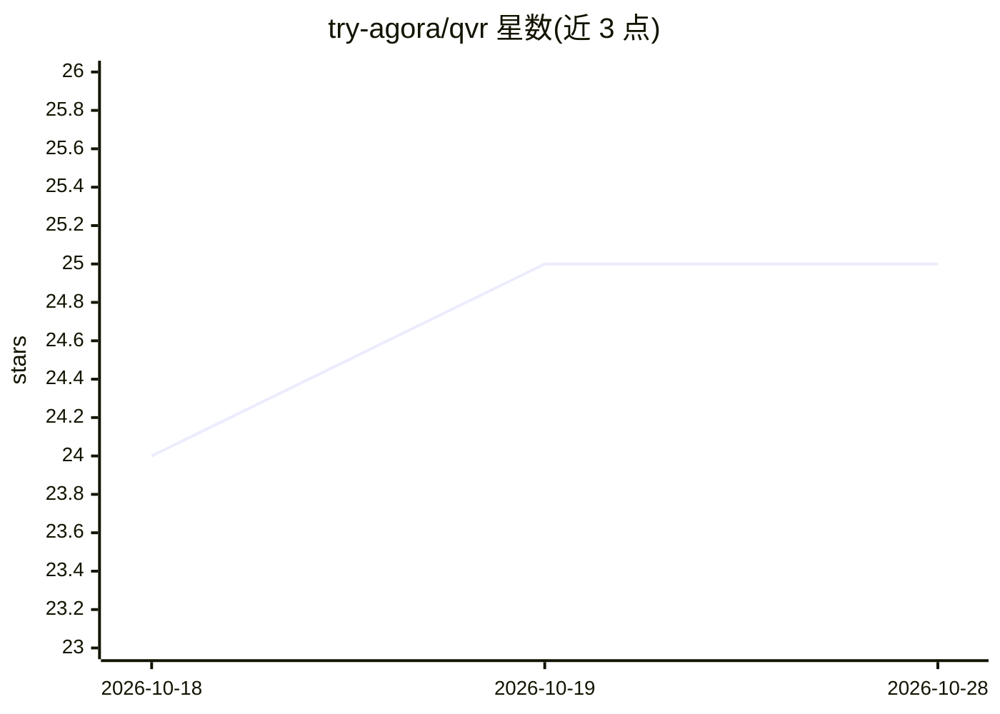

# try-agora/qvr

⭐ 25 · Go · MIT · 推送 2026-06-30 · [GitHub](https://github.com/try-agora/qvr) · 组织维护

**面向 AI agent 技能的 Git 原生包管理器 CLI（qvr）**

Quiver（qvr）是用 Go 编写的单一二进制 CLI，把 agent 技能（指令与脚本文件夹）当作依赖管理：resolve→lock→install→scan→symlink→reproduce→observe 全生命周期。基于原生 git，无守护进程与服务；安装采用 SHA 键控不可变存储与符号链接，每个安装前经 15 类安全扫描（提示注入、数据外泄等），qvr.toml/qvr.lock 双文件实现跨机字节级复现，支持 qvr audit 读取 agent 原生会话记录并投影为 OpenTelemetry spans，内置 qvr ui 仪表盘。目标用户为使用 Claude Code、Cursor、Copilot 等 60 余种 coding agent 的开发者与团队。限制：go install 不受支持，源码构建需 Go 1.25+ 与 Node 20+。

## 筛选速览

| 维度 | 判定 | 备注 |
|---|---|---|
| AI 角色 | `ai-ecosystem` | LLM/agent 周边工具 |
| 许可风险 | `permissive` | MIT |
| 部署形态 | `library` | 以包/库形式分发 |
| 模型依赖 | — | README 未给出锁定关系 |
| 硬件要求 | — | 无带数字的原话,不猜 |
| 安装摩擦 | `medium` | 含编译或系统依赖之一 |
| 成熟度 | — | 结构信号不足 |

## 能力要点

- Git 原生零服务 CLI，安装为 SHA 键控不可变存储 + 符号链接
- 每次安装前 15 类安全扫描（提示注入/数据外泄/供应链等），结果写入 lock 并可导出 SARIF
- qvr.toml + qvr.lock 双文件实现字节级可复现与 CI 门禁（lock verify --strict / sync --frozen）
- qvr audit 读取 agent 原生会话记录生成 OpenTelemetry spans，内置 qvr ui 仪表盘

## 适用场景

- 团队统一管理、锁定与复现各 coding agent 加载的技能集
- 在 CI 中验证技能安装与磁盘状态一致、拦截未锁定技能
- 审计技能运行：token 消耗、延迟、版本溯源与 A/B 对比

## 场景标签

`LLM 可观测性` · 领域:评测与运维

## 证据(README 行号)

> L23: unscanned, unattributable. Quiver is `uv` for agent skills: a Git-native,
> L30: — across every coding agent that reads skills from a directory: Claude Code,

## 星数曲线

2026-10-18 24 → 2026-10-28 25（+1）

---
*卡片 v1 · prompt 1.4 · 生成 2026-10-26 · 置信度 high · 依据 README sha `9cdc97818527` · [字段定义](../../DATASET.md)*
