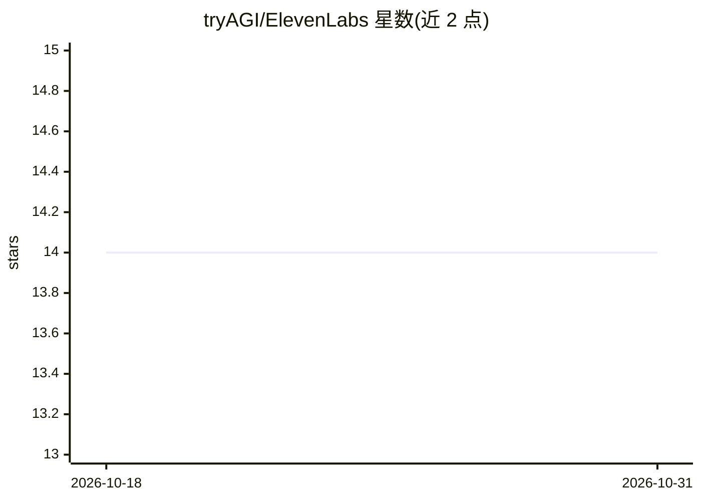

# tryAGI/ElevenLabs

⭐ 14 · C# · MIT · 推送 2026-10-30 · [GitHub](https://github.com/tryAGI/ElevenLabs) · [官网](https://tryagi.github.io/ElevenLabs/) · 组织维护

**ElevenLabs API 的 .NET/C# SDK：语音生成与转录接入**

tryAGI 维护的 ElevenLabs 官方风格 .NET SDK，由 AutoSDK 从 OpenAPI 规范生成。单一客户端覆盖文本转语音、流式合成（含字符级时间戳）、语音转文本、实时 WebSocket 转录、音乐生成、音效生成与即时声音克隆。实现 ISpeechToTextClient 接口，可直接接入 Microsoft.Extensions.AI 抽象。以 NuGet 包分发，需 API key 认证，属 tryAGI 维护的 200+ .NET SDK 生态成员，持续进行规范再生成与 NativeAOT/trimming 兼容审计。

## 筛选速览

| 维度 | 判定 | 备注 |
|---|---|---|
| AI 角色 | `ai-ecosystem` | LLM/agent 周边工具 |
| 许可风险 | `permissive` | MIT |
| 部署形态 | `None` |  |
| 模型依赖 | — | README 未给出锁定关系 |
| 硬件要求 | — | 无带数字的原话,不猜 |
| 安装摩擦 | `medium` | 含编译或系统依赖之一 |
| 成熟度 | — | 结构信号不足 |

## 能力要点

- 单客户端覆盖 TTS/STT/音乐生成/音效/声音克隆/实时转录
- 实现 ISpeechToTextClient，接入 Microsoft.Extensions.AI 抽象
- 由 AutoSDK 从 OpenAPI 规范生成，支持 nullability/trimming/NativeAOT
- 提供流式 TTS 与字符级时间戳输出

## 适用场景

- 在 .NET 应用中集成 ElevenLabs 语音合成与转录
- 构建实时流式转录或低延迟语音播放功能
- 通过 Microsoft.Extensions.AI 统一抽象调用语音转文本

## 场景标签

`语音合成` `语音识别` · 领域:内容生成

## 证据(README 行号)

> L2:  .NET SDK for ElevenLabs text to speech, speech to text, music generation, voice cloning, sound generation, and real
> L22:  Implements <code>ISpeechToTextClient</code> so the SDK plugs into <code>Microsoft.Extensions.AI</code> abstraction

## 星数曲线

2026-10-18 14 → 2026-10-31 14（+0）

---
*卡片 v1 · prompt 1.4 · 生成 2026-10-31 · 置信度 high · 依据 README sha `b627d21d847d` · [字段定义](../../DATASET.md)*
