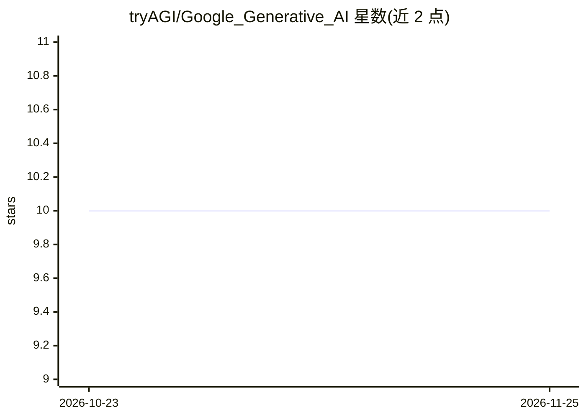

# tryAGI/Google_Generative_AI

⭐ 10 · C# · MIT · 推送 2026-11-22 · [GitHub](https://github.com/tryAGI/Google_Generative_AI) · [官网](https://tryagi.github.io/Google_Generative_AI/) · 组织维护

**面向 .NET 开发者的 Google Gemini API C# SDK**

由 AutoSDK 基于 Google Discovery 契约与 Interactions OpenAPI 契约生成的 C# 客户端库，供 .NET 开发者接入 Google Gemini API。支持聊天补全、嵌入、图像/视频/音乐生成、TTS/STT、文件管理与 Gemini Live API（WebSocket 实时双向语音/视频），实现 Microsoft.Extensions.AI 的 IChatClient、IEmbeddingGenerator 与 ISpeechToTextClient 接口。MIT 许可，NuGet 分发，目标 net10.0，支持 NativeAOT 等现代 .NET 特性。

## 筛选速览

| 维度 | 判定 | 备注 |
|---|---|---|
| AI 角色 | `ai-ecosystem` | LLM/agent 周边工具 |
| 许可风险 | `permissive` | MIT |
| 部署形态 | `None` |  |
| 模型依赖 | — | README 未给出锁定关系 |
| 硬件要求 | — | 无带数字的原话,不猜 |
| 安装摩擦 | `medium` | 含编译或系统依赖之一 |
| 成熟度 | — | 结构信号不足 |

## 能力要点

- 基于 AutoSDK 自动生成的 C# 客户端，随上游契约自动更新
- 实现 Microsoft.Extensions.AI 的 IChatClient/IEmbeddingGenerator/ISpeechToTextClient
- 支持 Gemini Live API 实时语音/视频会话（工具调用、会话恢复、自动重连）
- 覆盖文本、嵌入、图像/视频/音乐生成与 TTS/STT

## 适用场景

- 在 .NET 应用中接入 Gemini 聊天补全与流式输出
- 为 RAG/检索系统生成 Gemini 嵌入向量
- 构建实时语音/视频对话应用（Live API）
- 调用 Gemini 生成图像、视频与音乐内容

## 场景标签

 · 领域:LLM 基础设施/SDK

## 证据(README 行号)

> L9: - Generated C# clients based on Google's Discovery contract and Interactions OpenAPI contract using AutoSDK
> L14: - Microsoft.Extensions.AI `IChatClient`, `IEmbeddingGenerator` and `ISpeechToTextClient` support
> L23: using var client = new GeminiClient(apiKey);

## 星数曲线

2026-10-23 10 → 2026-11-25 10（+0）

---
*卡片 v1 · prompt 1.4 · 生成 2026-11-19 · 置信度 high · 依据 README sha `33b8fdf33149` · [字段定义](../../DATASET.md)*
