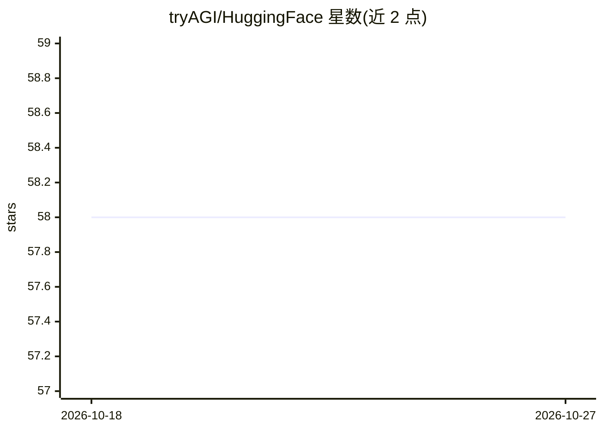

# tryAGI/HuggingFace

⭐ 58 · C# · MIT · 推送 2026-10-26 · [GitHub](https://github.com/tryAGI/HuggingFace) · [官网](https://tryagi.github.io/HuggingFace/) · 组织维护

**面向 .NET 开发者的 Hugging Face API C# SDK**

基于 AutoSDK 从 HuggingFace Hub、TGI、TEI 的 OpenAPI 规范生成的 C# SDK，以 NuGet 包分发，目标框架 net10.0。提供三个类型化客户端：HuggingFaceClient 覆盖 Hub API（账号信息、趋势模型、数据集与论文搜索），HuggingFaceInferenceClient 覆盖 TGI 聊天/补全，HuggingFaceEmbeddingClient 覆盖 TEI 嵌入、重排、相似度、稀疏嵌入与分词解码。支持 Microsoft.Extensions.AI 的 IChatClient 与 IEmbeddingGenerator 接口，启用可空性、 trimming、NativeAOT 与源生成 JSON。所有客户端需 HuggingFace API key，依赖远程托管服务，非本地推理。

## 筛选速览

| 维度 | 判定 | 备注 |
|---|---|---|
| AI 角色 | `ai-ecosystem` | LLM/agent 周边工具 |
| 许可风险 | `permissive` | MIT |
| 部署形态 | `None` |  |
| 模型依赖 | — | README 未给出锁定关系 |
| 硬件要求 | — | 无带数字的原话,不猜 |
| 安装摩擦 | `medium` | 含编译或系统依赖之一 |
| 成熟度 | — | 结构信号不足 |

## 能力要点

- 三个类型化客户端分别覆盖 Hub API、TGI 推理与 TEI 嵌入
- 实现 Microsoft.Extensions.AI 的 IChatClient 与 IEmbeddingGenerator 接口
- 支持 nullability、trimming、NativeAOT 与源生成 JSON
- 由 AutoSDK 生成，纳入 200+ .NET SDK 的自动化审计体系

## 适用场景

- 在 .NET 应用中调用 Hugging Face 托管模型做聊天与补全
- 生成文本嵌入、重排结果或稀疏嵌入
- 在 C# 代码中搜索 Hugging Face Hub 的模型、数据集与论文

## 场景标签

 · 领域:LLM 基础设施/开发者 SDK

## 证据(README 行号)

> L9: - Fully generated C# SDK based on HuggingFace Hub, TGI and TEI OpenAPI specs using AutoSDK
> L10: - Three typed clients: `HuggingFaceClient` (Hub API), `HuggingFaceInferenceClient` (TGI chat/completions), `Hugging
> L11: - Microsoft.Extensions.AI support: `IChatClient` and `IEmbeddingGenerator<string, Embedding<float>>`

## 星数曲线

2026-10-18 58 → 2026-10-27 58（+0）

---
*卡片 v1 · prompt 1.4 · 生成 2026-10-24 · 置信度 high · 依据 README sha `29d58446d43c` · [字段定义](../../DATASET.md)*
