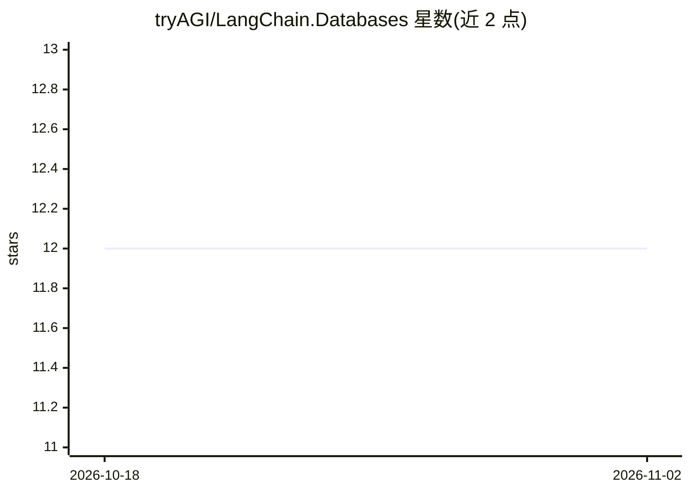

# tryAGI/LangChain.Databases

⭐ 12 · C# · MIT · 推送 2026-10-29 · [GitHub](https://github.com/tryAGI/LangChain.Databases) · [官网](https://tryagi.github.io/LangChain.Databases/) · 组织维护

**为 LangChain.NET 提供 .NET 向量库抽象与后端包**

LangChain.NET 生态中的数据库抽象库：基于 Microsoft.Extensions.VectorData.Abstractions（MEVA）实现向量存储接口，通过 NuGet 提供 PostgreSQL+pgvector、OpenSearch k-NN 向量库包，以及 Redis、MongoDB 聊天记录存储包，自身不依赖主项目、可独立使用。对于已有官方 Semantic Kernel 连接器的后端（Qdrant、Pinecone、Milvus 等），README 指引直接引用 SK 包。旧 IVectorDatabase 接口已被移除并提供迁移指南。面向 .NET/C# 开发者。

## 筛选速览

| 维度 | 判定 | 备注 |
|---|---|---|
| AI 角色 | `ai-ecosystem` | LLM/agent 周边工具 |
| 许可风险 | `permissive` | MIT |
| 部署形态 | `None` |  |
| 模型依赖 | — | README 未给出锁定关系 |
| 硬件要求 | — | 无带数字的原话,不猜 |
| 安装摩擦 | `low` | 无编译、无系统依赖或容器化 |
| 成熟度 | — | 结构信号不足 |

## 能力要点

- 实现 MEVA 的 VectorStore 抽象，可独立于 LangChain.NET 主项目使用
- NuGet 包：Postgres+pgvector、OpenSearch k-NN、Redis、Mongo 聊天记录
- 指引复用 Semantic Kernel 官方连接器（Qdrant/Pinecone/Milvus 等）

## 适用场景

- 在 .NET 应用中接入向量数据库做语义检索
- 为 LLM 应用保存聊天消息历史
- 统一抽象层下切换不同向量库后端

## 场景标签

`向量数据库` · 领域:知识与检索

## 证据(README 行号)

> L3: Database abstractions and vector store backends for the LangChain.NET ecosystem.
> L7: This project aligns with the **Microsoft.Extensions** ecosystem. For vector search, we use Microsoft.Extensions.Vect

## 星数曲线

2026-10-18 12 → 2026-11-02 12（+0）

---
*卡片 v1 · prompt 1.4 · 生成 2026-10-31 · 置信度 high · 依据 README sha `caa5f51c56f7` · [字段定义](../../DATASET.md)*
