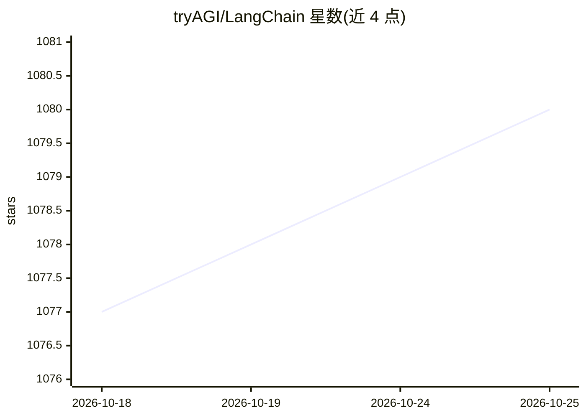

# tryAGI/LangChain

⭐ 1,081 · C# · MIT · 推送 2026-10-20 · [GitHub](https://github.com/tryAGI/LangChain) · [官网](https://tryagi.github.io/LangChain/) · 组织维护

**LangChain 的 C#/.NET 实现：可组合构建 LLM 应用**

LangChain 抽象的 C# 移植实现，目标是在抽象层面尽量贴近原版并保持对新实体的开放性。提供文档加载器（如 PDF）、SQLite 向量数据库等可组合依赖包，用于构建带嵌入与 LLM 调用的应用，示例给出了从零运行与重跑的费用估算。维护者声明单人难以完成重大进度，采取 24 小时内尽量合并 PR、招募核心团队并分享赞助的策略。以 NuGet 包分发，附 wiki、测试与示例。

## 筛选速览

| 维度 | 判定 | 备注 |
|---|---|---|
| AI 角色 | `ai-ecosystem` | LLM/agent 周边工具 |
| 许可风险 | `permissive` | MIT |
| 部署形态 | `None` |  |
| 模型依赖 | — | README 未给出锁定关系 |
| 硬件要求 | — | 无带数字的原话,不猜 |
| 安装摩擦 | `medium` | 含编译或系统依赖之一 |
| 成熟度 | — | 结构信号不足 |

## 能力要点

- LangChain 抽象的 C# 移植，包含文档加载器与 SQLite 向量库等组件包
- 示例给出从零运行与复用的 LLM 调用费用估算（$0.015 / $0.0004）
- 以 NuGet 包分发，提供 wiki、测试与示例工程

## 适用场景

- 在 .NET 技术栈中用可组合方式构建 LLM 应用
- C# 开发者参与 LangChain 生态的项目共建
- 搭建带嵌入与本地/付费模型的聊天应用（LangChainChat）

## 场景标签

`Agent 框架` `RAG` · 领域:Agent 开发

## 证据(README 行号)

> L10: ⚡ Building applications with LLMs through composability ⚡
> L12: C# implementation of LangChain. We try to be as close to the original as possible in terms of abstractions, but are

## 星数曲线

2026-10-18 1,077 → 2026-10-25 1,080（+3）

---
*卡片 v1 · prompt 1.4 · 生成 2026-10-21 · 置信度 high · 依据 README sha `8c62ad243f91` · [字段定义](../../DATASET.md)*
