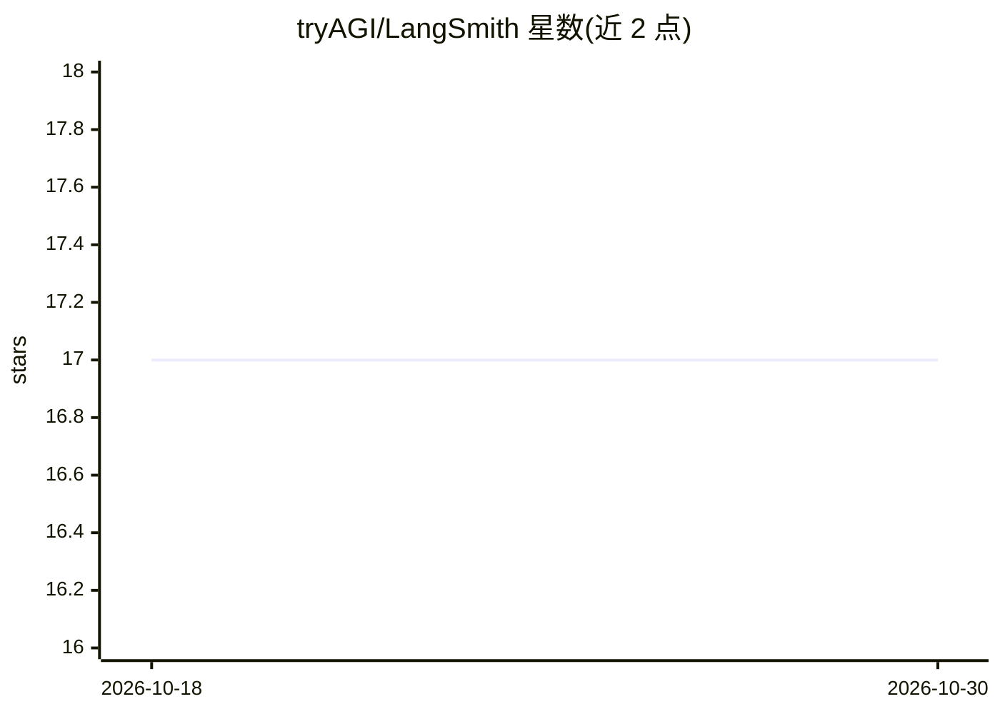

# tryAGI/LangSmith

⭐ 17 · C# · MIT · 推送 2026-10-29 · [GitHub](https://github.com/tryAGI/LangSmith) · [官网](https://tryagi.github.io/LangSmith/) · 组织维护

**面向 .NET 的 LangSmith SDK：接入 LangSmith 观测与追踪服务**

由 tryAGI 用 AutoSDK 从 LangSmith 官方 OpenAPI 规范生成的 C# SDK，覆盖数据集创建、健康检查、追踪（Trace）等 API 调用。支持 nullability、trimming、NativeAOT 等现代 .NET 特性，并兼容 .NET Framework/.NET Standard 2.0。OpenAPI 规范更新时自动发布新预览版。属于 tryAGI 维护的 200 余个 .NET SDK 生态的一部分，配套 SDK 审计持续检查规范同步与兼容性。给需要在 .NET 应用中接入 LangSmith 可观测性平台的开发者使用。

## 筛选速览

| 维度 | 判定 | 备注 |
|---|---|---|
| AI 角色 | `ai-ecosystem` | LLM/agent 周边工具 |
| 许可风险 | `permissive` | MIT |
| 部署形态 | `None` |  |
| 模型依赖 | — | README 未给出锁定关系 |
| 硬件要求 | — | 无带数字的原话,不猜 |
| 安装摩擦 | `medium` | 含编译或系统依赖之一 |
| 成熟度 | — | 结构信号不足 |

## 能力要点

- 基于官方 OpenAPI 规范全自动生成
- 规范更新时自动发布新预览版
- 支持 NativeAOT/trimming 与 .NET Framework/.NET Standard 2.0

## 适用场景

- 在 .NET 应用中调用 LangSmith 的数据集与追踪 API
- 为 LLM 应用接入 LangSmith 可观测性平台
- 在 AOT 编译的 .NET 项目中使用 LangSmith 客户端

## 场景标签

`LLM 可观测性` · 领域:评测与运维

## 证据(README 行号)

> L9: - Fully generated C# SDK based on official OpenAPI specification using AutoSDK
> L39: ### Trace
> L49: This SDK is one of more than 200 .NET SDKs maintained with AutoSDK. The tryAGI SDK audit continuously checks reposi

## 星数曲线

2026-10-18 17 → 2026-10-30 17（+0）

---
*卡片 v1 · prompt 1.4 · 生成 2026-10-29 · 置信度 high · 依据 README sha `11614ad51446` · [字段定义](../../DATASET.md)*
