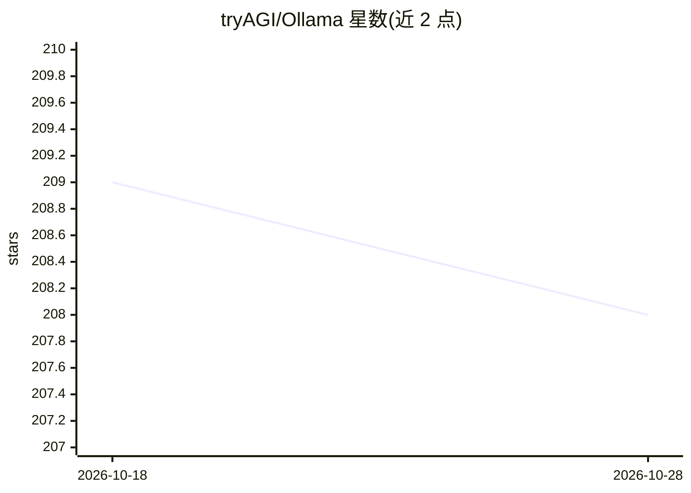

# tryAGI/Ollama

⭐ 208 · C# · MIT · 推送 2026-10-27 · [GitHub](https://github.com/tryAGI/Ollama) · [官网](https://tryagi.github.io/Ollama/) · 组织维护

**面向 .NET 开发者的 Ollama 官方风格 SDK，接入本地 LLM**

基于官方 Ollama OpenAPI 规范用 AutoSDK 全自动生成的 C# SDK，覆盖 Ollama 全部 API 端点：聊天、流式生成、嵌入、模型列表/拉取/创建等。提供源生成器以 C# 接口原生定义工具，支持 nullability、trimming、NativeAOT，并兼容 .NET Framework/.NET Standard 2.0 与 Microsoft.Extensions.AI（实现 IChatClient 与 IEmbeddingGenerator）。官方 OpenAPI 规范变更时自动发布新预览版。以 NuGet 包形式分发。

## 筛选速览

| 维度 | 判定 | 备注 |
|---|---|---|
| AI 角色 | `ai-ecosystem` | LLM/agent 周边工具 |
| 许可风险 | `permissive` | MIT |
| 部署形态 | `None` |  |
| 模型依赖 | local-ok | 支持本地模型 |
| 硬件要求 | — | 无带数字的原话,不猜 |
| 安装摩擦 | `medium` | 含编译或系统依赖之一 |
| 成熟度 | — | 结构信号不足 |

## 能力要点

- 基于官方 Ollama OpenAPI 规范用 AutoSDK 全自动生成，规范变更自动发新预览版
- 覆盖全部 Ollama API 端点：聊天、嵌入、模型拉取/创建/列表等
- 源生成器支持以 C# 接口原生定义工具调用
- 实现 Microsoft.Extensions.AI 的 IChatClient 与 IEmbeddingGenerator

## 适用场景

- 在 .NET 应用中调用本地 Ollama 服务进行聊天与嵌入
- 通过 Microsoft.Extensions.AI 抽象统一接入 Ollama
- 用 C# 接口定义工具并接入 Ollama 模型调用

## 场景标签

 · 领域:LLM 基础设施/.NET SDK

## 证据(README 行号)

> L9: - Fully generated C# SDK based on the official Ollama OpenAPI specification using AutoSDK
> L14: - Support for all Ollama API endpoints including chats, embeddings, listing models, pulling and creating new models

## 星数曲线

2026-10-18 209 → 2026-10-28 208（-1）

---
*卡片 v1 · prompt 1.4 · 生成 2026-10-22 · 置信度 high · 依据 README sha `db058a6a52c5` · [字段定义](../../DATASET.md)*
