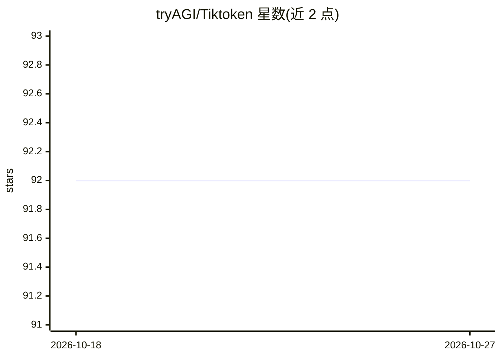

# tryAGI/Tiktoken

⭐ 92 · C# · MIT · 推送 2026-10-20 · [GitHub](https://github.com/tryAGI/Tiktoken) · [官网](https://www.nuget.org/packages/Tiktoken/) · 组织维护

**.NET 高性能 BPE 分词器库，供开发者集成模型 tokenization**

C#/.NET 实现的 BPE 分词器库，以 NuGet 包提供。支持 o200k_base/o200k_harmony/cl100k_base/r50k_base/p50k_base/p50k_edit 编码，可加载 HuggingFace tokenizer.json 格式（兼容 GPT-2、Llama 3、Qwen2、DeepSeek 等），支持 OpenAI 聊天格式的消息 token 计数（含函数/工具定义）、自定义 .tiktoken/.ttkb 编码文件。特性包括零分配计数、多语言缓存（CJK 文本 5-13x 加速）、O(n log n) min-heap BPE 合并；兼容性测试基于官方 tiktoken 0.14.0。另附 NativeAOT 编译的 ttok CLI 工具，brew 安装。

## 筛选速览

| 维度 | 判定 | 备注 |
|---|---|---|
| AI 角色 | `ai-ecosystem` | LLM/agent 周边工具 |
| 许可风险 | `permissive` | MIT |
| 部署形态 | `None` |  |
| 模型依赖 | — | README 未给出锁定关系 |
| 硬件要求 | — | 无带数字的原话,不猜 |
| 安装摩擦 | `medium` | 含编译或系统依赖之一 |
| 成熟度 | — | 结构信号不足 |

## 能力要点

- 实现 6 种编码，可按模型名自动选择（如 GPT-4o、gpt-oss、gpt-5）
- 支持加载 HuggingFace tokenizer.json，覆盖 GPT-2/Llama 3/Qwen2/DeepSeek 等
- 零分配 token 计数，内置多语言缓存，CJK 文本缓存加速 5-13x
- OpenAI 官方公式的消息 token 计数，支持嵌套函数/工具参数定义

## 适用场景

- 在 .NET 应用中为 LLM 调用计算 token 数以控制成本
- 加载 HuggingFace 格式 tokenizer.json 对接开源模型
- 通过 ttok CLI 在命令行中计数与探索 token

## 场景标签

 · 领域:LLM 基础设施/分词器

## 证据(README 行号)

> L25: var encoder = TikTokenEncoder.CreateForModel(Models.Gpt4o);
> L31: The `Tiktoken.Encodings.Tokenizer` package enables loading any HuggingFace-format `tokenizer.json` file — supportin

## 星数曲线

2026-10-18 92 → 2026-10-27 92（+0）

---
*卡片 v1 · prompt 1.4 · 生成 2026-10-23 · 置信度 high · 依据 README sha `0cae7df8a48b` · [字段定义](../../DATASET.md)*
