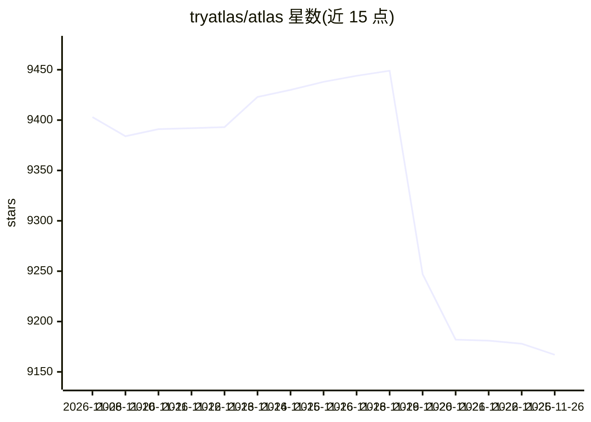

# tryatlas/atlas

⭐ 9,167 · TypeScript · Apache-2.0 · 推送 2026-11-25 · [GitHub](https://github.com/tryatlas/atlas) · [官网](https://www.tryatlas.cc/) · 组织维护

**给工程团队记录并管理多个编码 agent 会话的协作层**

Atlas 提供桌面应用与 CLI 两种形态，将团队运行的多个编码 agent（Claude Code、Codex 等）的会话记录到本地 sessions 数据库，并把每条 commit 通过 checkpoint 关联回产生它的会话。提供跨 agent 共享记忆（本地嵌入与 HNSW 检索）、@ 文件/会话引用、团队时间线与评论、成本与 token 统计看板。本地模式下无账号无网络可用；云端同步仅同步会话记录，不上传源码树。

## 筛选速览

| 维度 | 判定 | 备注 |
|---|---|---|
| AI 角色 | `ai-ecosystem` | LLM/agent 周边工具 |
| 许可风险 | `permissive` | Apache-2.0 |
| 部署形态 | `desktop` | 安装包/桌面程序 |
| 模型依赖 | — | README 未给出锁定关系 |
| 硬件要求 | — | 无带数字的原话,不猜 |
| 安装摩擦 | `low` | 无编译、无系统依赖或容器化 |
| 成熟度 | — | 结构信号不足 |

## 能力要点

- checkpoint 将 commit 关联回产生它的 agent 会话，链接可在 rebase/amend 后保持
- 设备端共享记忆服务器，多个 agent 读写同一份记忆与语义索引
- 组织时间线上查看、评论团队成员的实时或历史会话
- 密钥在写入本地前先行脱敏

## 适用场景

- 生产事故排查时追踪到是哪个 agent 的哪次会话改了代码
- 团队并行运行多个编码 agent 并统一查看其历史
- 统计各 agent 与模型的 token 消耗和每次提交成本

## 场景标签

`Agent 记忆` · 领域:Agent 开发

## 证据(README 行号)

> L43: **Atlas CLI.** Happy in your terminal? `atlas-cli` hooks into the agents you already run (Claude Code, Codex, Curso
> L51: Atlas is a "control-surface IDE" built around managing your agents' context.
> L97: Claude Code and Codex run as external subprocesses over ACP and get the most support due to their popularity. Atlas

## 星数曲线

2026-11-08 9,403 → 2026-11-26 9,167（-236）

---
*卡片 v1 · prompt 1.4 · 生成 2026-11-26 · 置信度 high · 依据 README sha `7d85b4316873` · [字段定义](../../DATASET.md)*
