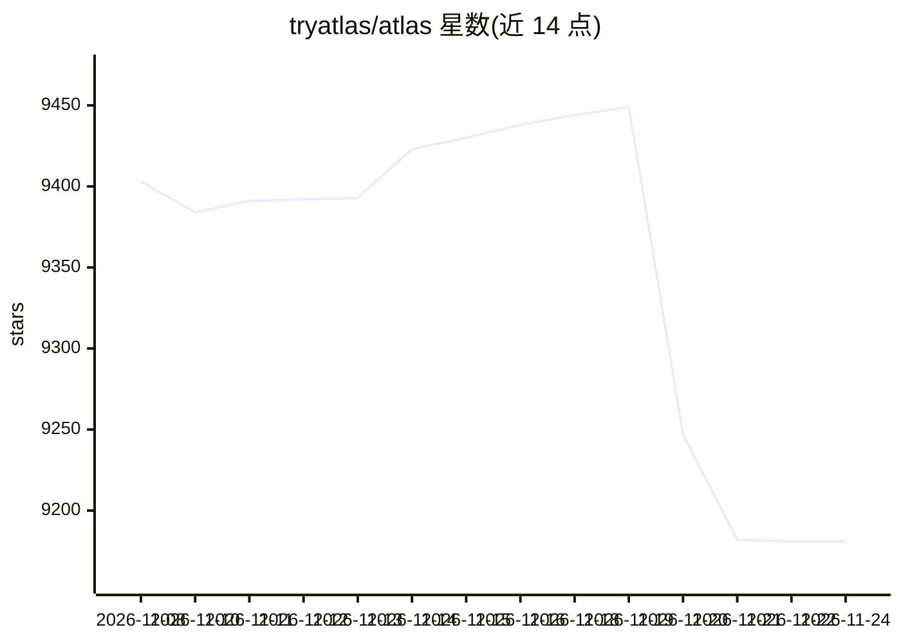

# tryatlas/atlas

⭐ 9,181 · TypeScript · Apache-2.0 · 推送 2026-11-21 · [GitHub](https://github.com/tryatlas/atlas) · [官网](https://www.tryatlas.cc/) · 组织维护

**给编码 Agent 团队做会话记录、commit 关联与协作的时间线工具**

Atlas 提供桌面应用与 CLI 两种形态，把团队运行的多个编码 Agent（Claude Code、Codex、Cursor、OpenCode 等）的会话记录到本地 sessions.db，并将 commit 与产生它的会话以 checkpoint 形式关联，链接可在 rebase/amend 后通过 patch-id 对账维持。会话捕获默认关闭、按项目开启，写入前在本机做密钥脱敏；本地模式无需账户与网络。管理侧提供 ROI 仪表盘（按项目/人/模型统计 token 与成本），团队侧提供共享时间线、会话评论与聊天频道。

## 筛选速览

| 维度 | 判定 | 备注 |
|---|---|---|
| AI 角色 | `ai-ecosystem` | LLM/agent 周边工具 |
| 许可风险 | `permissive` | Apache-2.0 |
| 部署形态 | `desktop` | 安装包/桌面程序 |
| 模型依赖 | — | README 未给出锁定关系 |
| 硬件要求 | — | 无带数字的原话,不猜 |
| 安装摩擦 | `low` | 无编译、无系统依赖或容器化 |
| 成熟度 | — | 结构信号不足 |

## 能力要点

- checkpoint 将 commit 关联到产生它的 Agent 会话，可在 rebase/amend 后保持链接
- 共享 Agent 记忆：本机嵌入索引（HNSW），各 Agent 经记忆服务器读写
- @ 提及在本地 Rust 解析，文件夹解析为指针而非粘贴进上下文
- 运行本机 Agent 时仅同步会话记录，不同步源码树且先脱敏

## 适用场景

- 团队用多个编码 Agent 时追踪哪次会话改了哪行代码
- 生产事故回溯到触发变更的 prompt 与会话
- 统计团队的 Agent token 消耗与每次提交成本
- 远程从浏览器或手机接管正在运行的 Agent 会话

## 场景标签

`Agent 记忆` · 领域:Agent 开发

## 证据(README 行号)

> L31: That's why we built Atlas: every coding agent your team runs, recorded and linked to the commits it produced, on a 
> L43: **Atlas CLI.** Happy in your terminal? `atlas-cli` hooks into the agents you already run (Claude Code, Codex, Curso

## 星数曲线

2026-11-08 9,403 → 2026-11-24 9,181（-222）

---
*卡片 v1 · prompt 1.4 · 生成 2026-11-22 · 置信度 high · 依据 README sha `7a4c1e01c647` · [字段定义](../../DATASET.md)*
