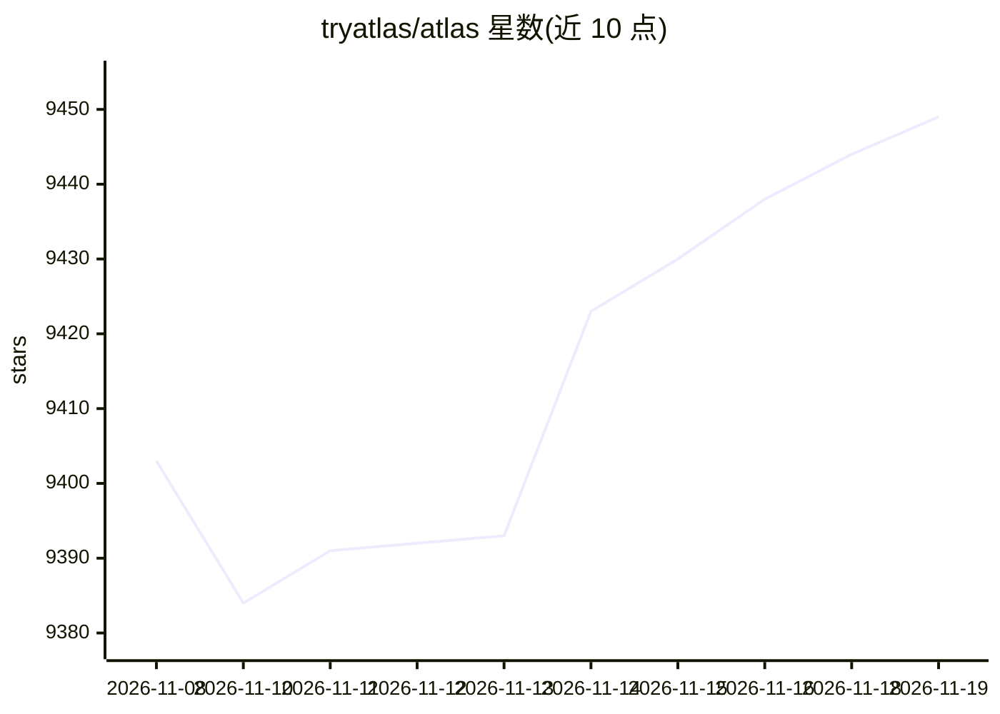

# tryatlas/atlas

⭐ 9,449 · TypeScript · Apache-2.0 · 推送 2026-11-18 · [GitHub](https://github.com/tryatlas/atlas) · [官网](https://www.tryatlas.cc/) · 组织维护

**给团队的编码代理可视化与控制层：记录代理会话并关联提交**

面向使用多个编码代理的工程团队的桌面应用与 CLI：以子进程方式运行 Claude Code、Codex 等 ACP 注册代理，本地记录每个会话于 .atlas/sessions.db（写入前脱敏），并将提交关联为 checkpoint，含会话、提示与工具调用记录，链接可存活于 rebase/amend。提供跨代理共享记忆（本地嵌入 + HNSW 语义索引）、团队时间线、评论与 ROI 仪表盘。无账户可离线使用；仅同步代理工作记录，不同步源码树。

## 筛选速览

| 维度 | 判定 | 备注 |
|---|---|---|
| AI 角色 | `ai-ecosystem` | LLM/agent 周边工具 |
| 许可风险 | `permissive` | Apache-2.0 |
| 部署形态 | `desktop` | 安装包/桌面程序 |
| 模型依赖 | — | README 未给出锁定关系 |
| 硬件要求 | — | 无带数字的原话,不猜 |
| 安装摩擦 | `low` | 无编译、无系统依赖或容器化 |
| 成熟度 | — | 结构信号不足 |

## 能力要点

- 会话捕获与 checkpoint：提交关联到产生它的代理会话，rebase/amend 后链接存活
- 跨代理共享记忆：本地嵌入与 HNSW 语义索引，经设备端 memory server 读写
- 支持 Claude Code、Codex 外部子进程及 ACP 注册代理（Cursor、OpenCode、Kilo Code 等）并行运行
- 团队时间线、会话级评论与按项目/人/模型的用量与成本统计

## 适用场景

- 团队追踪哪个代理、哪个提示导致某次提交或故障
- 在统一界面并行运行并管理多个编码代理
- 让不同编码代理共享记忆与上下文 briefing
- 衡量团队各项目的 AI 花费与产出（cost per commit）

## 场景标签

`LLM 可观测性` `Agent 记忆` · 领域:Agent 开发

## 证据(README 行号)

> L31: That's why we built Atlas: every coding agent your team runs, recorded and linked to the commits it produced, on a 
> L97: Claude Code and Codex run as external subprocesses over ACP and get the most support due to their popularity. Atlas
> L109: |**Shared agent memory**|Active plan, decisions, file changes, failures, and architecture notes, written by any ag

## 星数曲线

2026-11-08 9,403 → 2026-11-19 9,449（+46）

---
*卡片 v1 · prompt 1.4 · 生成 2026-11-17 · 置信度 high · 依据 README sha `c0b35729f201` · [字段定义](../../DATASET.md)*
