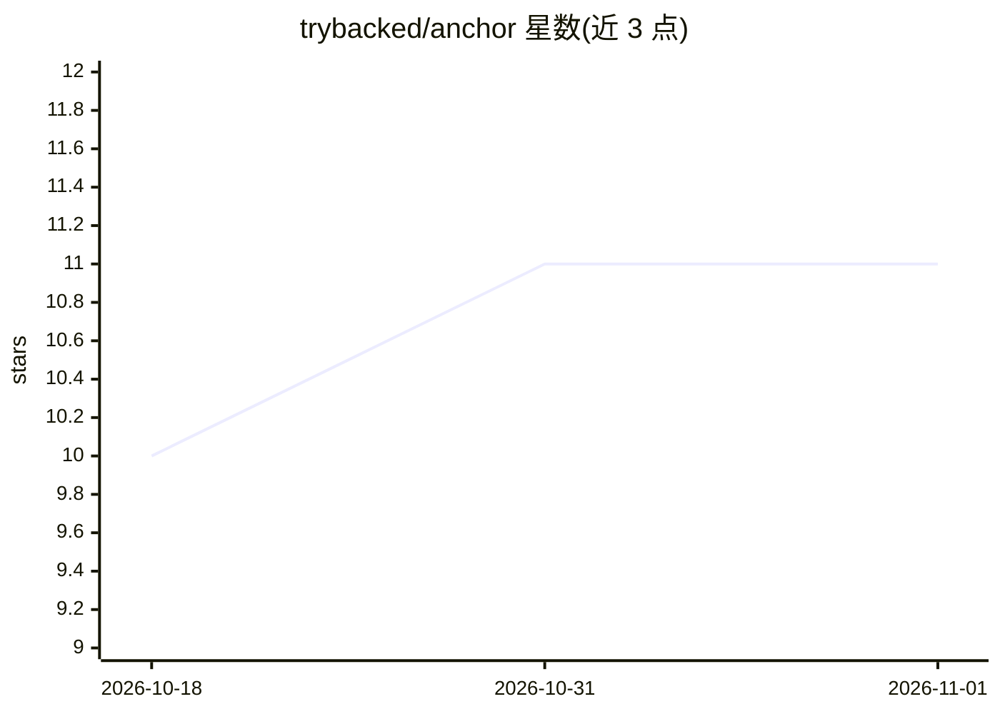

# trybacked/anchor

⭐ 11 · TypeScript · NOASSERTION · 推送 2026-10-17 · [GitHub](https://github.com/trybacked/anchor) · [官网](https://backed.app/) · 组织维护

**组织数据的治理本体层：对象/关系/逻辑/动作的版本化与审计**

Anchor 是位于既有数据系统之上的治理本体层，不替代原始系统、不做摄取管道。它从文件系统文档集合或仓库 schema 中确定性地发现结构，生成包含对象、属性、关系、逻辑与动作的 model.yaml，经 sync 冻结为版本化注册表，再通过 deploy 以 MCP（stdio）供 agent 消费。发现过程不使用语言模型；AI 仅在编写阶段将检查结果转化为需人工评审的变更集，查询路径上无模型调用。面向需要给 agent 提供可信、可审计数据定义的组织，以 TypeScript 实现并提供 npm CLI。限制：文件引擎尚不支持对象 SQL 查询。

## 筛选速览

| 维度 | 判定 | 备注 |
|---|---|---|
| AI 角色 | `ai-ecosystem` | LLM/agent 周边工具 |
| 许可风险 | `permissive` | NOASSERTION |
| 部署形态 | `library` | 以包/库形式分发 |
| 模型依赖 | — | README 未给出锁定关系 |
| 硬件要求 | — | 无带数字的原话,不猜 |
| 安装摩擦 | `low` | 无编译、无系统依赖或容器化 |
| 成熟度 | — | 结构信号不足 |

## 能力要点

- 确定性发现（仅文件元数据与统计，不用语言模型）
- 本体元素记录置信度、出处、评审状态与生命周期
- sync 冻结版本，agent 经 MCP 消费已同步注册表，查询路径无模型调用
- AI 编写以变更集形式提出，破坏性变更强制人工评审

## 适用场景

- 为 AI agent 提供经评审、可版本化回滚的组织数据定义
- 在多个数据系统之上维护一份可审计的数据语义层
- 需要数据不出本地基础设施的 agent 数据接入

## 场景标签

`知识图谱` · 领域:知识与检索

## 证据(README 行号)

> L9:  MCP
> L111: |Agents|MCP over the agreed ontology, with no model call on the query path|
> L112: |AI authoring|Ontology and semantics proposed as change sets, gated by review policy|

## 星数曲线

2026-10-18 10 → 2026-11-01 11（+1）

---
*卡片 v1 · prompt 1.4 · 生成 2026-11-01 · 置信度 high · 依据 README sha `5f73b1b181c5` · [字段定义](../../DATASET.md)*
