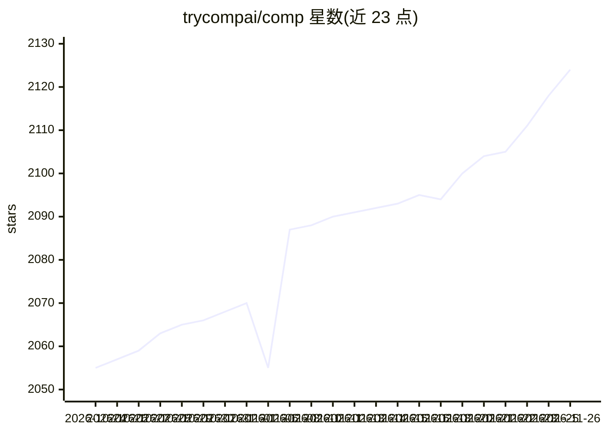

# trycompai/comp

⭐ 2,124 · TypeScript · AGPL-3.0 · 推送 2026-11-23 · [GitHub](https://github.com/trycompai/comp) · [官网](https://trycomp.ai) · 组织维护

**开源自托管合规平台，自动化企业合规取证流程**

Comp AI Community Edition 是可自托管的开源合规平台，面向需要满足 SOC 2、ISO 27001、HIPAA、GDPR 等框架的企业，自动化证据收集、策略管理与控制项实施。技术栈为 Next.js + Prisma + Trigger.dev + Upstash，需 Node.js、Bun 与 Postgres 运行，通过 Docker 启动数据库，依赖 Google OAuth、Trigger.dev Cloud、Resend、Upstash 等外部服务凭据。仓库版本为 AGPLv3 许可，官方另提供独立代码库的付费托管版 Comp AI Cloud。

## 筛选速览

| 维度 | 判定 | 备注 |
|---|---|---|
| AI 角色 | `ai-enhanced` | 去掉 AI 部分产品仍成立 |
| 许可风险 | `viral` | AGPL-3.0 |
| 部署形态 | `library` | 以包/库形式分发 |
| 模型依赖 | — | README 未给出锁定关系 |
| 硬件要求 | — | 无带数字的原话,不猜 |
| 安装摩擦 | `low` | 无编译、无系统依赖或容器化 |
| 成熟度 | — | 结构信号不足 |

## 能力要点

- 自动化证据收集、策略管理与控制项实施
- 支持 SOC 2、ISO 27001、HIPAA、GDPR 等框架
- 自托管（AGPLv3）与付费托管云版双形态
- Turborepo 单仓多应用，发布 npm 包（db/email/kv/ui）

## 适用场景

- 企业准备 SOC 2 / ISO 27001 审计时的证据收集
- 需要数据留在自有基础设施的合规管理
- 安全团队集中管理合规策略与控制项

## 场景标签

`网络安全` · 领域:学习与行业

## 证据(README 行号)

> L29: ### AI that handles compliance for you in hours.
> L31: Comp AI is the fastest way to get compliant with frameworks like SOC 2, ISO 27001, HIPAA and GDPR. Comp AI automate

## 星数曲线

2026-10-24 2,055 → 2026-11-26 2,124（+69）

---
*卡片 v1 · prompt 1.4 · 生成 2026-11-23 · 置信度 mid · 依据 README sha `8fd1558e37dc` · [字段定义](../../DATASET.md)*
