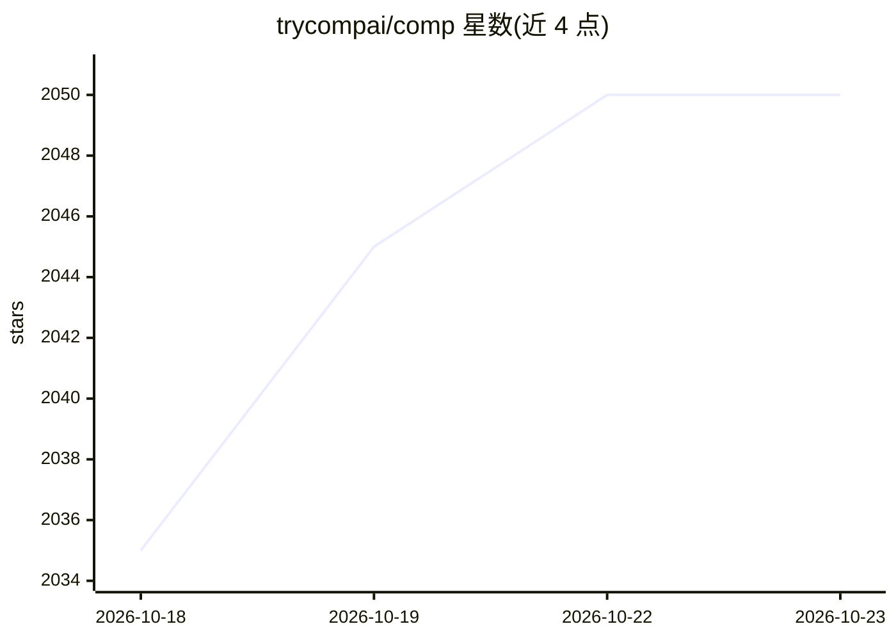

# trycompai/comp

⭐ 2,050 · TypeScript · AGPL-3.0 · 推送 2026-10-22 · [GitHub](https://github.com/trycompai/comp) · [官网](https://trycomp.ai) · 组织维护

**开源合规平台：AI 协助企业完成 SOC 2/ISO 27001 等合规**

面向企业合规的开源平台，覆盖 SOC 2、ISO 27001、HIPAA、GDPR 等框架，自动化证据收集、政策管理与控制实施，数据与基础设施由用户掌控。基于 Next.js、Trigger.dev、Prisma、Upstash 等构建，本地运行需 Node.js、Bun 与 Postgres，并需配置 Google OAuth、Trigger.dev、Upstash Redis 等外部服务。采用 Open Core 模式：99% 代码 AGPLv3 开源，约 1% 企业版功能需商业许可。Docker/Vercel 部署文档标注'即将推出'。

## 筛选速览

| 维度 | 判定 | 备注 |
|---|---|---|
| AI 角色 | `ai-native` | 本体是模型或模型工具 |
| 许可风险 | `dual` | AGPL-3.0 |
| 部署形态 | `library` | 以包/库形式分发 |
| 模型依赖 | — | README 未给出锁定关系 |
| 硬件要求 | — | 无带数字的原话,不猜 |
| 安装摩擦 | `low` | 无编译、无系统依赖或容器化 |
| 成熟度 | — | 结构信号不足 |

## 能力要点

- 自动化证据收集、政策管理与控制实施
- 支持 SOC 2、ISO 27001、HIPAA、GDPR 等合规框架
- AGPLv3 开源，Open Core 模式含企业版商业许可
- 以 Turborepo 组织，发布 @trycompai 系列内部包到 npm

## 适用场景

- 初创公司准备 SOC 2 或 ISO 27001 认证时收集证据和管理政策
- 在自有基础设施上运行合规平台掌控数据
- 替代 Vanta/Drata 等商业合规 SaaS 自托管部署

## 场景标签

 · 领域:企业合规/信息安全

## 证据(README 行号)

> L28: ### AI that handles compliance for you in hours.
> L30: Comp AI is the fastest way to get compliant with frameworks like SOC 2, ISO 27001, HIPAA and GDPR. Comp AI automate
> L352: Comp AI, Inc. is a commercial open source company, which means some parts of this open source repository require a

## 星数曲线

2026-10-18 2,035 → 2026-10-23 2,050（+15）

---
*卡片 v1 · prompt 1.4 · 生成 2026-10-21 · 置信度 mid · 依据 README sha `508fd835f700` · [字段定义](../../DATASET.md)*
