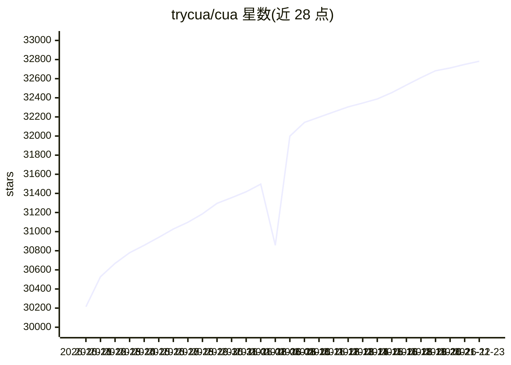

# trycua/cua

⭐ 32,782 · Rust · MIT · 推送 2026-11-22 · [GitHub](https://github.com/trycua/cua) · [官网](https://cua.ai) · 组织维护

**为 computer-use agent 提供桌面自动化驱动、沙箱与评测基准**

Cua 是一套面向 computer-use agent 的工具集合：Cua Driver 提供在 macOS/Windows/Linux 上检查和操作原生应用与浏览器的接口（CLI/MCP/SDK 接入）；Lume 基于 Apple Virtualization.Framework 管理本地 macOS/Linux 虚拟机；cua SDK/CLI 提供 Python、TypeScript、Rust 的沙箱 API 与 gVisor 容器；CUA-S1 是用于表单类计算机操作决策的小型专用模型（权重托管在 Hugging Face）；Cua Bench 用于构建任务、评测 agent 并导出轨迹。Cua Spaces 桌面应用为 FSL-1.1-MIT 源码可用许可并含付费档位。

## 筛选速览

| 维度 | 判定 | 备注 |
|---|---|---|
| AI 角色 | `ai-ecosystem` | LLM/agent 周边工具 |
| 许可风险 | `permissive` | MIT |
| 部署形态 | `desktop` | 安装包/桌面程序 |
| 模型依赖 | — | README 未给出锁定关系 |
| 硬件要求 | — | 无带数字的原话,不猜 |
| 安装摩擦 | `low` | 无编译、无系统依赖或容器化 |
| 成熟度 | `idea` | |

## 动量与使用信号

- 维护:`active` — 距上次 push 0.7 天,年发版 100,149 位贡献者
- 涨星:近 1 天 **+107**(自 20261016 起算)
- 安装:pypi 包 `cua` 月下载 11,861
- 平台:WINDOWS / MACOS / LINUX · 协议:MCP

## 能力要点

- Cua Driver 支持通过 CLI、MCP、typed SDK 驱动 macOS/Windows/Linux 应用
- Python/TypeScript/Rust 三语言 SDK 与 `cua` CLI，沙箱内无需 agent
- Lume 在 Apple Silicon 上创建和管理 macOS/Linux VM
- Cua Bench 构建任务、评测 agent、导出训练轨迹

## 适用场景

- 让 agent 在真实桌面应用中执行并验证操作结果
- 为 agent 搭建可复现的 macOS/Linux 沙箱环境
- 构建 computer-use 评测任务并导出轨迹用于训练
- 评估不同 agent 在同一桌面任务上的表现

## 场景标签

`GUI 自动化` `模型评测` · 领域:效率与自动化

## 证据(README 行号)

> L7:  Combine your existing computers into one supercomputer. Cua Spaces: your computers, shared by your team and its age
> L71: Give your agent tools to inspect and operate native desktop apps and browsers on macOS, Windows, and Linux. Connect
> L189: |cua-bench|Benchmarks and RL environments for computer-use|

## 星数曲线

2026-10-21 30,214 → 2026-11-23 32,782（+2,568）

---
*卡片 v1 · prompt 1.4 · 生成 2026-11-22 · 置信度 high · 依据 README sha `5b473636c983` · [字段定义](../../DATASET.md)*
