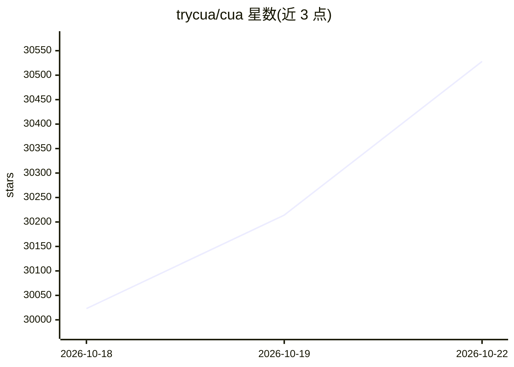

# trycua/cua

⭐ 30,528 · Rust · MIT · 推送 2026-10-21 · [GitHub](https://github.com/trycua/cua) · [官网](https://cua.ai) · 组织维护

**给 AI agent 提供可用计算机的开源驱动、沙箱与评测工具集**

Cua AI, Inc. 维护的 computer-use agent 基础设施仓库，含五个组件：Cua Spaces 桌面应用（在本地 Mac/自有机器/自有云账号上为 agent 提供 macOS/Linux 完整桌面）、Cua Driver（macOS/Windows/Linux 上检查与操作原生应用和浏览器的自动化工具，经 CLI/MCP/类型化 SDK 接入）、Lume（Apple Silicon 上基于 Virtualization.Framework 的本地 VM 管理）、CUA-S1 小型专用决策模型（早期源码研究发布，权重在 Hugging Face）与 Cua Bench（构建任务、评测 agent、导出轨迹）。SDK 覆盖 Python/TypeScript/Swift/Kotlin。个人版免费，Pro/Teams 付费；仓库内 MIT 与 FSL-1.1-MIT 双许可并存。

## 筛选速览

| 维度 | 判定 | 备注 |
|---|---|---|
| AI 角色 | `ai-ecosystem` | LLM/agent 周边工具 |
| 许可风险 | `permissive` | MIT |
| 部署形态 | `desktop` | 安装包/桌面程序 |
| 模型依赖 | — | README 未给出锁定关系 |
| 硬件要求 | — | 无带数字的原话,不猜 |
| 安装摩擦 | `low` | 无编译、无系统依赖或容器化 |
| 成熟度 | `idea` | |

## 动量与使用信号

- 维护:`active` — 距上次 push 0.7 天,年发版 100,149 位贡献者
- 涨星:近 1 天 **+107**(自 20261016 起算)
- 安装:pypi 包 `cua` 月下载 11,861
- 平台:WINDOWS / MACOS / LINUX · 协议:MCP

## 能力要点

- Cua Spaces：在自有机器与自有云账号上运行 agent 专用完整桌面，支持 Teleport 迁移已登录应用
- Cua Driver：跨 macOS/Windows/Linux 检查并操作原生应用与浏览器，支持 CLI/MCP/SDK 接入
- Lume：基于 Apple Virtualization.Framework 创建本地 macOS/Linux VM
- Cua Bench：无需 VM/Docker/API key 即可构建并评测 computer-use 任务

## 适用场景

- 让我的 agent 在隔离的 macOS/Linux 沙箱里执行桌面操作
- 为 computer-use agent 构建评测任务并导出训练轨迹
- 在 Apple Silicon 上本地创建和管理 agent 使用的 VM

## 场景标签

`GUI 自动化` `浏览器自动化` `模型评测` · 领域:效率与自动化

## 证据(README 行号)

> L7:  Give AI agents computers they can use. Cua Spaces gives your agents full desktops on your Mac and on machines you o
> L43: Bring your own agent and model, or explore CUA-S1 for specialized decisions. Cua provides the computer and automati
> L69: Give your agent tools to inspect and operate native desktop apps and browsers on macOS, Windows, and Linux. Connect

## 星数曲线

2026-10-18 30,023 → 2026-10-22 30,528（+505）

---
*卡片 v1 · prompt 1.4 · 生成 2026-10-20 · 置信度 high · 依据 README sha `3b441b8bccf3` · [字段定义](../../DATASET.md)*
