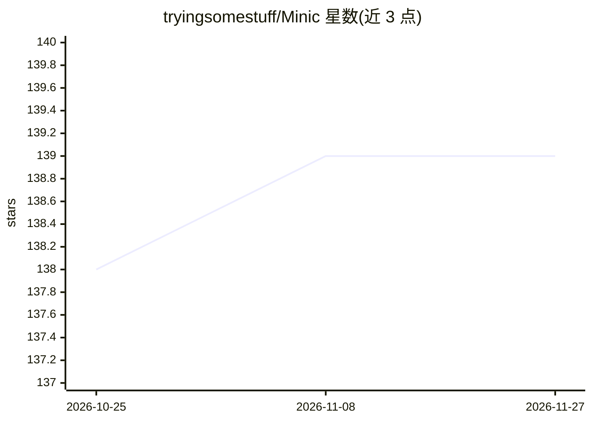

# tryingsomestuff/Minic

⭐ 139 · C++ · GPL-3.0 · 推送 2026-11-21 · [GitHub](https://github.com/tryingsomestuff/Minic) · 个人维护

**支持 UCI/CECP 协议的国际象棋引擎，含 NNUE 评估**

作者用于学习国际象棋编程与现代 C++ 的开源引擎项目，2018 年起从一个单文件周末项目演进为多文件 C++ 代码库。无图形界面，兼容 CECP (xboard) 与 UCI 两种协议，可接入 Cutechess、Arena、Banksia、Winboard 等对局软件。自 3.00 版起使用基于 Seer 实现改编的 NNUE 评估网络，训练代码为独立的 Python 工具，网络文件单独发布在 NNUE-Nets 仓库且版本间不向后兼容。作者提供二进制发行版与源码构建方式，并设有 Patreon 赞助渠道。

## 筛选速览

| 维度 | 判定 | 备注 |
|---|---|---|
| AI 角色 | `ai-native` | 本体是模型或模型工具 |
| 许可风险 | `viral` | GPL-3.0 |
| 部署形态 | `desktop` | 安装包/桌面程序 |
| 模型依赖 | — | README 未给出锁定关系 |
| 硬件要求 | — | 无带数字的原话,不猜 |
| 安装摩擦 | `low` | 无编译、无系统依赖或容器化 |
| 成熟度 | — | 结构信号不足 |

## 能力要点

- 兼容 CECP (xboard) 与 UCI 协议，可接入多种对局 GUI 与测试工具
- 自 3.00 版起使用基于 Seer 改编的 NNUE 评估网络，网络文件在独立仓库发布
- 提供多种 CPU 架构的构建目标（如 skylake/znver1）与多线程支持
- 内置 random-mover 模式（level=0）

## 适用场景

- 在 Cutechess/Arena 等软件中与该引擎对弈或进行引擎测试
- 学习国际象棋引擎的搜索、评估与 NNUE 训练实现
- 在自己的测试框架中通过 UCI 协议调用引擎

## 场景标签

 · 领域:游戏/棋牌引擎

## 证据(README 行号)

> L2: Minic is a chess engine I'm developing to learn about chess programming and modern C++ (please see this lovely wiki 
> L4: Minic has no graphical interface (GUI) but is compatible with both the CECP (xboard) and UCI protocols, so you can u
> L53: Starting from release 3.00, **Minic is not using Stockfish NNUE implementation anymore and is no more compatible wi

## 星数曲线

2026-10-25 138 → 2026-11-27 139（+1）

---
*卡片 v1 · prompt 1.4 · 生成 2026-11-27 · 置信度 high · 依据 README sha `e679bd02cd06` · [字段定义](../../DATASET.md)*
