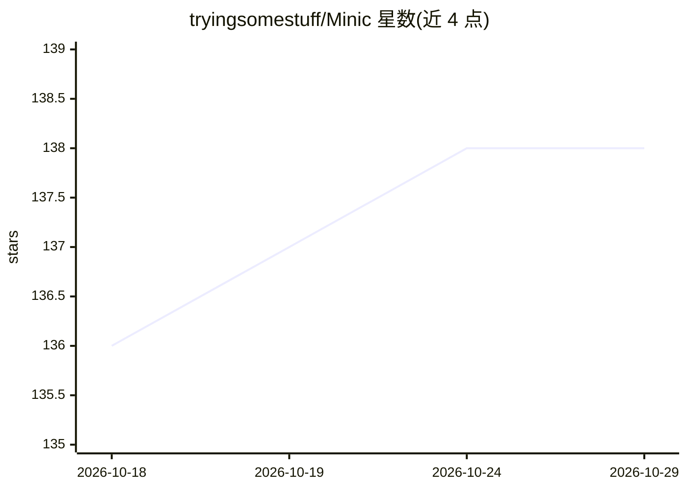

# tryingsomestuff/Minic

⭐ 138 · C++ · GPL-3.0 · 推送 2026-10-20 · [GitHub](https://github.com/tryingsomestuff/Minic) · 个人维护

**开源国际象棋引擎：NNUE 评估 + 搜索，UCI/CECP 协议**

个人开发者在 2018 年以周末项目起步的 C++ 国际象棋引擎，无 GUI，通过 UCI 与 CECP 协议接入 Cutechess、Arena、Winboard 等界面软件使用。评估采用借鉴 Seer 实现并自行改造的 NNUE 网络（自版本 3.00 起不再兼容 Stockfish NNUE 实现与 SF 网络），训练代码为独立的 Python 工具，数据由引擎自身生成或用旧版本重标注。支持多线程（测试显示 250 线程下 1 亿 NPS），NNUE 建议在 AVX2 硬件上运行。源码与二进制两种获取方式。

## 筛选速览

| 维度 | 判定 | 备注 |
|---|---|---|
| AI 角色 | `ai-native` | 本体是模型或模型工具 |
| 许可风险 | `viral` | GPL-3.0 |
| 部署形态 | `desktop` | 安装包/桌面程序 |
| 模型依赖 | — | README 未给出锁定关系 |
| 硬件要求 | — | 无带数字的原话,不猜 |
| 安装摩擦 | `low` | 无编译、无系统依赖或容器化 |
| 成熟度 | — | 结构信号不足 |

## 能力要点

- NNUE 评估网络（自 Seer 实现改造，网络不跨版本兼容）
- UCI 与 CECP 双协议，可在 Cutechess/Arena/Winboard 等软件中使用
- 多线程搜索，README 给出最多 250 线程的速度测试数据
- 独立的 Python 训练工具，数据由引擎自身生成或重标注

## 适用场景

- 在支持 UCI 的棋类界面软件中作为对弈引擎
- 参加计算机国际象棋赛事或评级列表测试
- 学习国际象棋引擎编程与 NNUE 训练流程

## 场景标签

 · 领域:游戏/棋类 AI

## 证据(README 行号)

> L35: #### NNUE from release 2.47 to release 2.53 (from Stockfish implementation)
> L70: - Inference code : originally based on Seer's one (Connor McMonigle), with many refactorings and experiments inside

## 星数曲线

2026-10-18 136 → 2026-10-29 138（+2）

---
*卡片 v1 · prompt 1.4 · 生成 2026-10-22 · 置信度 high · 依据 README sha `98da62d1cb0d` · [字段定义](../../DATASET.md)*
