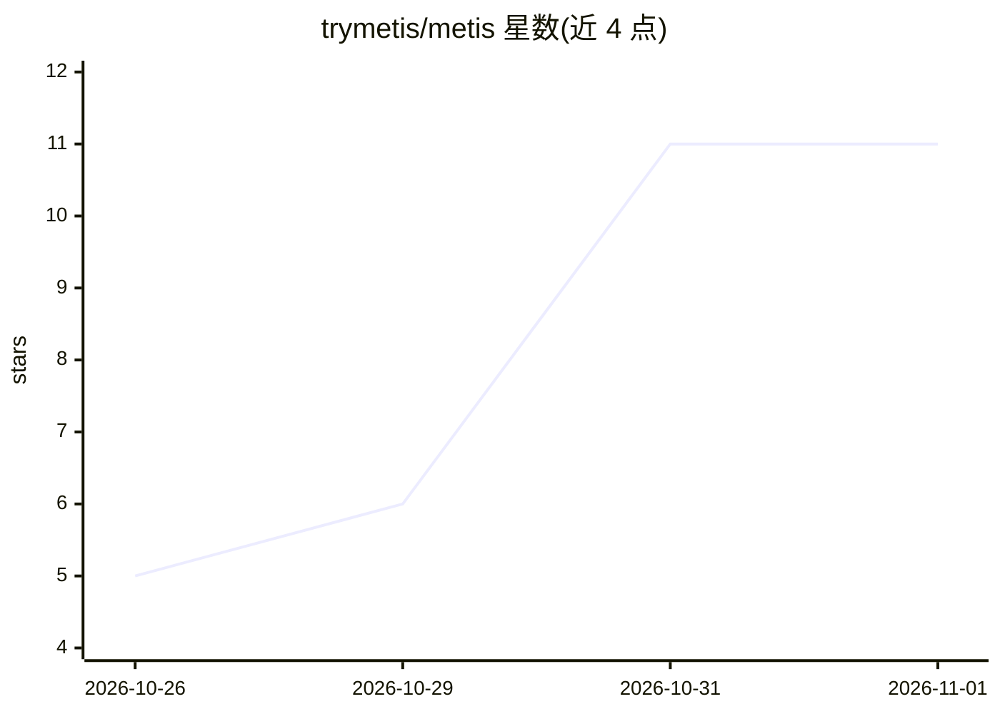

# trymetis/metis

⭐ 11 · TypeScript · AGPL-3.0 · 推送 2026-10-31 · [GitHub](https://github.com/trymetis/metis) · [官网](https://www.trymetis.email) · 组织维护

**自托管邮件/日历/网盘聚合客户端，附 AI 助手与自动化工作流**

开源的邮件、日历与网盘统一客户端，聚合 Gmail、Outlook、Zoho、IMAP、CalDAV 及 S3/WebDAV 等账户到单一界面，并提供跨账户问答的 AI 助手、可视化自动化工作流、钓鱼预警与 MCP 接入。自托管通过一键脚本安装 Docker 环境，也可使用官方托管云；AI 默认关闭，支持 OpenAI、Anthropic 或任意 OpenAI 兼容 API（含自托管模型），操作需用户批准。AGPL-3.0 许可。

## 筛选速览

| 维度 | 判定 | 备注 |
|---|---|---|
| AI 角色 | `ai-enhanced` | 去掉 AI 部分产品仍成立 |
| 许可风险 | `viral` | AGPL-3.0 |
| 部署形态 | `self-host` | docker 或自建部署 |
| 模型依赖 | — | README 未给出锁定关系 |
| 硬件要求 | — | 无带数字的原话,不猜 |
| 安装摩擦 | `low` | 无编译、无系统依赖或容器化 |
| 成熟度 | — | 结构信号不足 |

## 能力要点

- 聚合多账户邮件、日历、网盘到单一应用
- AI 助手跨邮箱/日历/网盘问答，改动需用户批准
- 画布式工作流支持新邮件/事件/webhook 触发与 AI 步骤
- MCP 接入：Claude、Cursor、VS Code 等客户端可访问其数据

## 适用场景

- 把多个 Gmail/Outlook/IMAP 账户收进一个自托管收件箱
- 让 AI 助手跨邮件、日历和文件回答问题并代为操作
- 用工作流自动处理新邮件或日历事件

## 场景标签

`AI 助手` `工作流自动化` · 领域:效率与自动化

## 证据(README 行号)

> L18: Metis Suite is an open-source mail, calendar and drive client. It connects to the accounts you already have (Gmail,
> L23: - **AI on your terms.** Bring your own model from OpenAI, Anthropic, or anything with an OpenAI-compatible API, inc

## 星数曲线

2026-10-26 5 → 2026-11-01 11（+6）

---
*卡片 v1 · prompt 1.4 · 生成 2026-11-01 · 置信度 high · 依据 README sha `6988fe22b3fd` · [字段定义](../../DATASET.md)*
