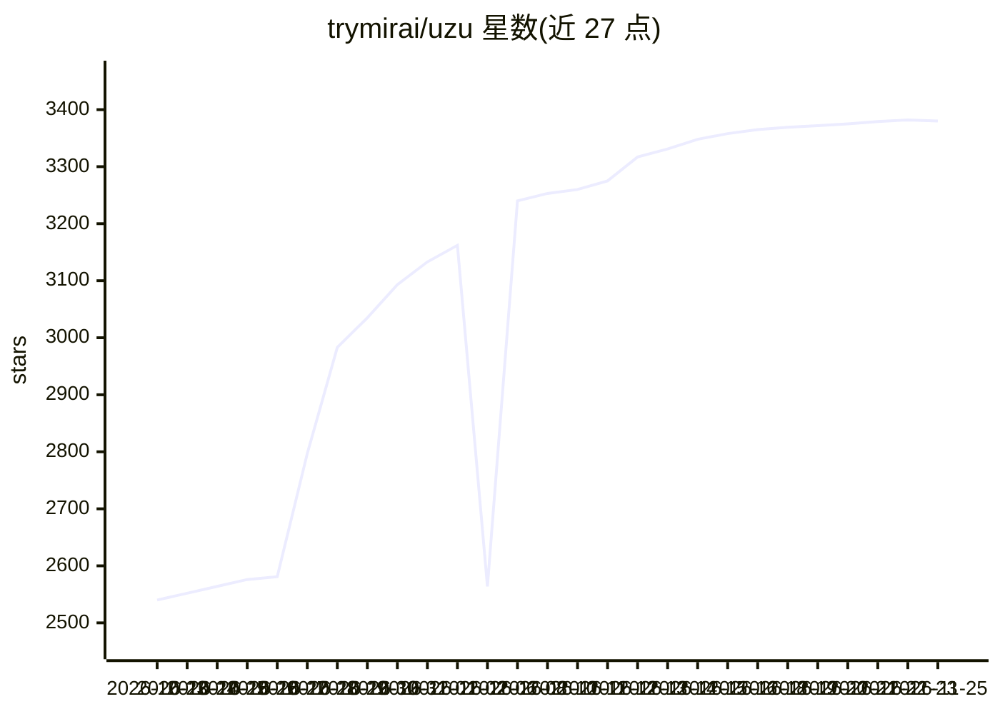

# trymirai/uzu

⭐ 3,380 · Rust · MIT · 推送 2026-11-23 · [GitHub](https://github.com/trymirai/uzu) · [官网](https://trymirai.com) · 组织维护

**嵌入应用的本地模型推理引擎，Rust 实现多语言绑定**

Uzu 是一个用 Rust 编写的 AI 模型推理引擎，支持通过 Rust、Python（pyo3）、Swift（uniffi-rs）、TypeScript（napi-rs）四语言 API 将模型直接部署进应用，实现本地零延迟推理。提供统一模型配置、可追溯计算、Apple 统一内存利用与结构化输出（Grammar/JSON schema）、工具调用等能力。后端支持 Metal、实验性 Vulkan 与 CPU；可导出自有模型格式，也可运行 OpenAI 兼容的 HTTP 服务器与 CLI。MIT 许可，模型下载与推理配置自动处理，开发环境经 cargo tools setup 安装依赖。

## 筛选速览

| 维度 | 判定 | 备注 |
|---|---|---|
| AI 角色 | `ai-ecosystem` | LLM/agent 周边工具 |
| 许可风险 | `permissive` | MIT |
| 部署形态 | `library` | 以包/库形式分发 |
| 模型依赖 | — | README 未给出锁定关系 |
| 硬件要求 | — | 无带数字的原话,不猜 |
| 安装摩擦 | `low` | 无编译、无系统依赖或容器化 |
| 成熟度 | — | 结构信号不足 |

## 能力要点

- Rust 原生 crate，提供 Python/Swift/TypeScript 绑定
- 后端支持 Metal、实验性 Vulkan 与 CPU
- 支持结构化输出（JSON schema）与工具调用
- 可启动 OpenAI 兼容 HTTP 服务器与 CLI 交互界面

## 适用场景

- 在 iOS/macOS 应用中本地运行 LLM 推理
- 搭建本地 OpenAI 兼容推理服务
- 将模型以 SDK 形式嵌入 Rust/Python/TS 项目
- 使用决策模型对状态文本做结构化问答

## 场景标签

`推理引擎` · 领域:训练与推理

## 证据(README 行号)

> L7: A high-performance inference engine for AI models. It allows you to deploy AI directly in your app with **zero laten
> L298: `uzu` is a native Rust crate with bindings available for:

## 星数曲线

2026-10-23 2,540 → 2026-11-25 3,380（+840）

---
*卡片 v1 · prompt 1.4 · 生成 2026-11-23 · 置信度 high · 依据 README sha `0cd9fb049411` · [字段定义](../../DATASET.md)*
