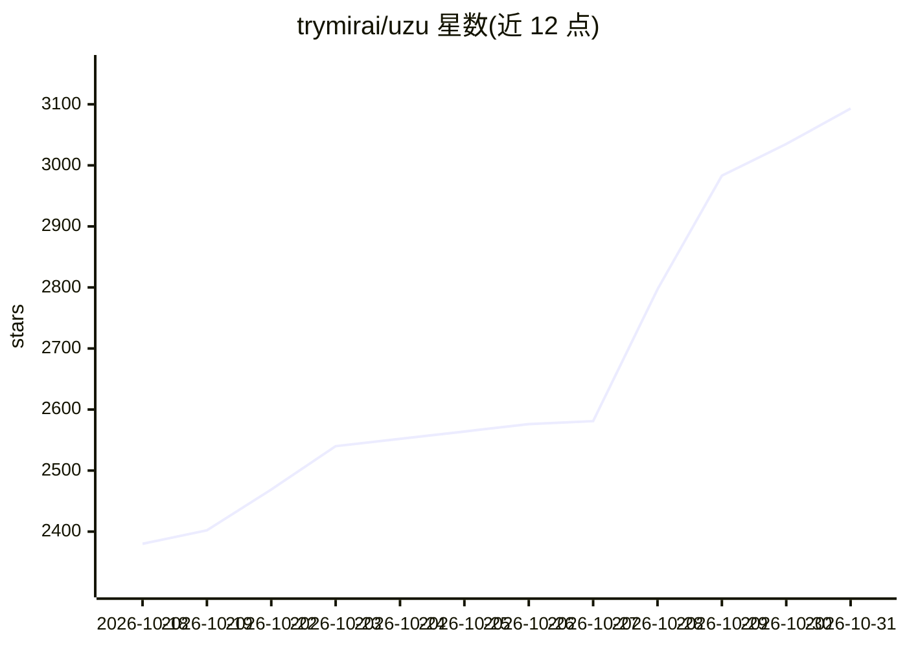

# trymirai/uzu

⭐ 3,093 · Rust · MIT · 推送 2026-10-30 · [GitHub](https://github.com/trymirai/uzu) · [官网](https://trymirai.com) · 组织维护

**Rust 推理引擎：在应用内本地运行 LLM，多语言绑定**

原生 Rust 实现的 AI 模型推理引擎，通过 pyo3/uniffi-rs/napi-rs 提供 Python、Swift、TypeScript 绑定，宣称面向应用内本地部署。统一模型配置格式，模型需经配套工具 lalamo 导出为其自有格式。后端支持 Metal 与 CPU，目标平台以 Apple 系（macOS/iOS/macCatalyst）为主，Windows/Linux/WASM 目标注明 in progress。附带 CLI（交互式模型浏览下载）与 OpenAI 兼容 HTTP 服务器，支持流式输出、JSON 结构化输出与工具调用。

## 筛选速览

| 维度 | 判定 | 备注 |
|---|---|---|
| AI 角色 | `ai-ecosystem` | LLM/agent 周边工具 |
| 许可风险 | `permissive` | MIT |
| 部署形态 | `library` | 以包/库形式分发 |
| 模型依赖 | — | README 未给出锁定关系 |
| 硬件要求 | — | 无带数字的原话,不猜 |
| 安装摩擦 | `low` | 无编译、无系统依赖或容器化 |
| 成熟度 | `idea` | |

## 能力要点

- Rust/Python/Swift/TypeScript 四语言绑定
- Metal 与 CPU 后端，利用 Apple 统一内存
- OpenAI 兼容 HTTP 服务器（/v1/chat/completions，支持流式）
- Grammar 指定 JSON schema 的结构化输出与工具调用

## 适用场景

- 在 iOS/macOS 应用中嵌入本地 LLM 推理
- 以 OpenAI 兼容 API 形式在本地提供服务
- 多语言项目中复用同一本地推理引擎

## 场景标签

`推理引擎` · 领域:训练与推理

## 证据(README 行号)

> L7: A high-performance inference engine for AI models. It allows you to deploy AI directly in your app with **zero laten
> L298: `uzu` is a native Rust crate with bindings available for:

## 星数曲线

2026-10-18 2,380 → 2026-10-31 3,093（+713）

---
*卡片 v1 · prompt 1.4 · 生成 2026-10-21 · 置信度 high · 依据 README sha `6ce928965a73` · [字段定义](../../DATASET.md)*
