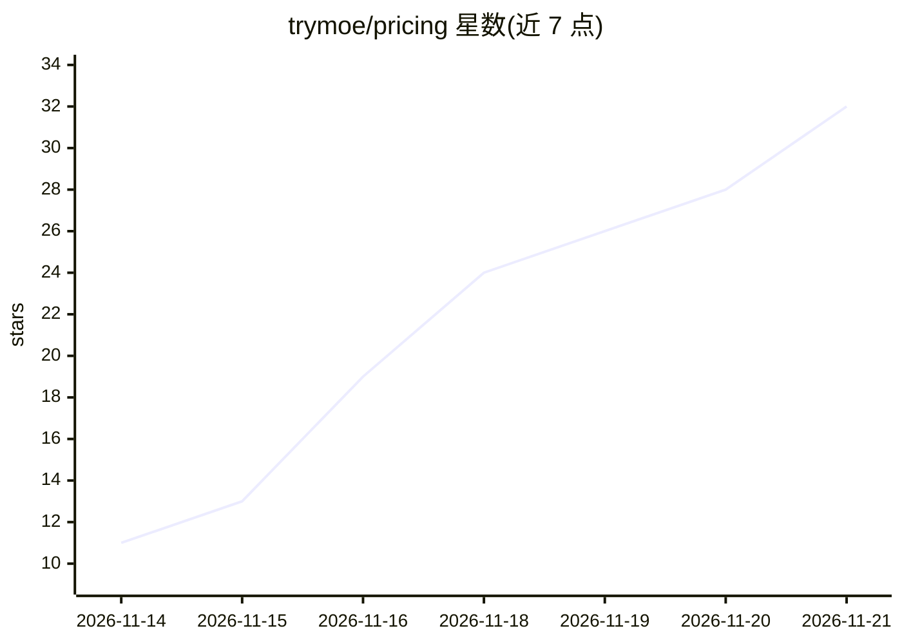

# trymoe/pricing

⭐ 32 · JavaScript · MIT · 推送 2026-11-15 · [GitHub](https://github.com/trymoe/pricing) · [官网](https://try.moe/) · 组织维护 · 中文 README

**零依赖的 AI API token 成本估算 TypeScript 库**

从 TryMoe 抽取计算逻辑形成的独立 npm 包，用于估算 AI API 调用费用：分离输入/输出 token 单价与分母，支持促销时段、输入上下文分层定价、IANA 时区的峰谷时段与夏令时规则，以及调用方提供的 USD/CNY 汇率换算。面向 TypeScript/JavaScript 开发者，提供 ES 模块与类型声明，Node.js 与浏览器均可运行，无运行时依赖。内置无真实厂商价格目录，不含分词器，也明确不覆盖缓存、批量、图像音频计费等场景；仅供估算，非计费引擎。

## 筛选速览

| 维度 | 判定 | 备注 |
|---|---|---|
| AI 角色 | `ai-ecosystem` | LLM/agent 周边工具 |
| 许可风险 | `permissive` | MIT |
| 部署形态 | `library` | 以包/库形式分发 |
| 模型依赖 | — | README 未给出锁定关系 |
| 硬件要求 | — | 无带数字的原话,不猜 |
| 安装摩擦 | `low` | 无编译、无系统依赖或容器化 |
| 成熟度 | — | 结构信号不足 |

## 能力要点

- 输入/输出 token 分开计价，支持分层与时段定价规则
- 支持 IANA 时区的峰谷时段、星期规则与夏令时
- 零运行时依赖，输出 Node.js 与浏览器 ES 模块及 TypeScript 声明
- 提供 estimateCost/effectivePrice/validatePrice API 与严格输入校验

## 适用场景

- 在应用中估算 AI API 调用的 token 成本
- 按促销时段或峰谷时段规则模拟费用
- 在浏览器本地运行成本试算 demo

## 场景标签

 · 领域:LLM 基础设施/成本计算

## 证据(README 行号)

> L5: A small, dependency-free runtime for **AI API token cost estimates**. Extracted from the pure calculation logic in T
> L14: - Node.js and browser ES modules, TypeScript declarations, no runtime dependencies.

## 星数曲线

2026-11-14 11 → 2026-11-21 32（+21）

---
*卡片 v1 · prompt 1.4 · 生成 2026-11-18 · 置信度 high · 依据 README sha `91838b9b4ad8` · [字段定义](../../DATASET.md)*
