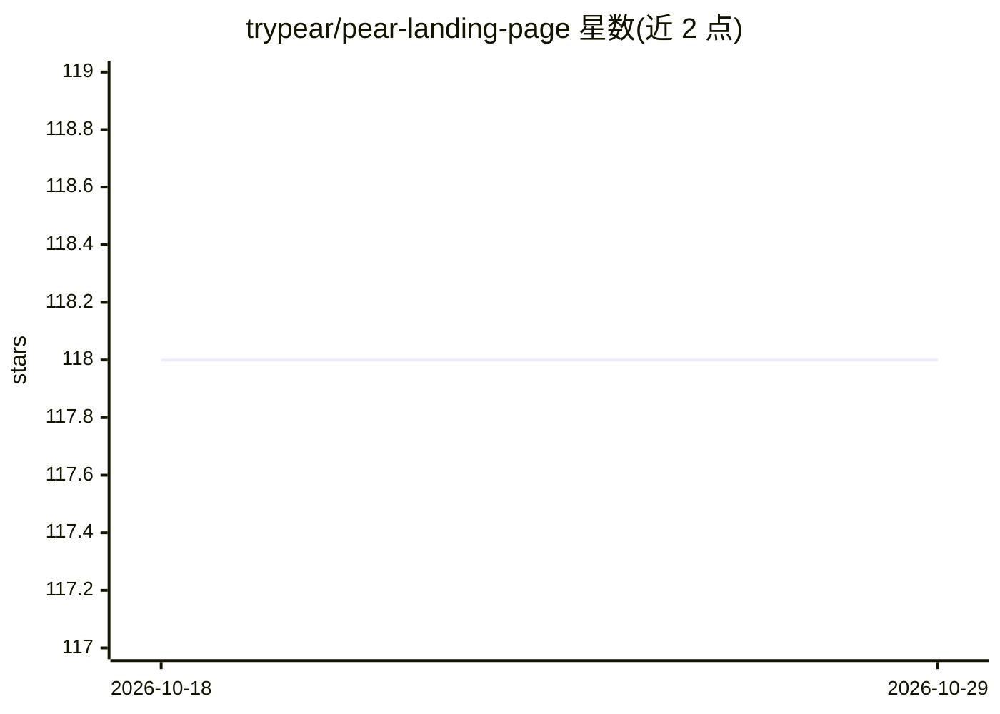

# trypear/pear-landing-page

⭐ 118 · TypeScript · Apache-2.0 · 推送 2025-12-27 · [GitHub](https://github.com/trypear/pear-landing-page) · [官网](https://trypear.ai) · 组织维护

**PearAI 开源 AI 代码编辑器的官网落地页**

基于 Next.js、Vercel、Tailwind CSS 和 TypeScript 构建的 PearAI 落地页项目。PearAI 本体是开源 AI 代码编辑器，本仓库仅托管其介绍网站。本地运行需先安装 Yarn，克隆仓库后 yarn install 安装依赖，配置 .env.local 中的 Supabase 环境变量（URL 与匿名 key），再以 yarn dev 启动开发服务器并访问 localhost:3000。项目带 Prettier/ESLint 的 pre-commit 检查。

## 筛选速览

| 维度 | 判定 | 备注 |
|---|---|---|
| AI 角色 | `ai-ecosystem` | LLM/agent 周边工具 |
| 许可风险 | `permissive` | Apache-2.0 |
| 部署形态 | `library` | 以包/库形式分发 |
| 模型依赖 | — | README 未给出锁定关系 |
| 硬件要求 | — | 无带数字的原话,不猜 |
| 安装摩擦 | `low` | 无编译、无系统依赖或容器化 |
| 成熟度 | — | 结构信号不足 |

## 能力要点

- 基于 Next.js + Tailwind CSS + TypeScript 构建
- 需配置 Supabase 环境变量（NEXT_PUBLIC_SUPABASE_URL / ANON_KEY）
- yarn dev 启动本地开发服务器

## 适用场景

- 为 PearAI 编辑器搭建或修改官网落地页
- 参与 PearAI 网站的前端贡献

## 场景标签

 · 领域:Web 前端/官网

## 证据(README 行号)

> L5:  The Open Source AI-powered code editor
> L17: This is the landing page for PearAI: the Open Source AI-powered code editor.

## 星数曲线

2026-10-18 118 → 2026-10-29 118（+0）

---
*卡片 v1 · prompt 1.4 · 生成 2026-10-23 · 置信度 low · 依据 README sha `448f78df00fc` · [字段定义](../../DATASET.md)*
