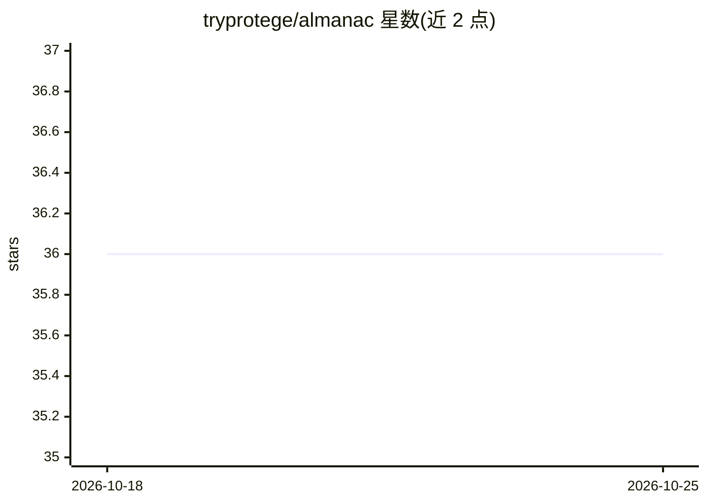

# tryprotege/almanac

⭐ 36 · TypeScript · Apache-2.0 · 推送 2026-02-24 · [GitHub](https://github.com/tryprotege/almanac) · [官网](https://docs.tryprotege.com/almanac) · 组织维护

**面向 AI agent 的图增强数据访问平台（LightRAG+MCP）**

为 AI agent 提供统一数据访问的平台：通过 MCP server 接入 GitHub、Notion、Fathom、Slack 等数据源，同步记录后做向量与图索引，基于 LightRAG 算法提供 5 种查询模式（naive/local/global/hybrid/mix）。自身以 MCP server 形式暴露能力，可接入 Claude Desktop、Cline、ChatGPT 等 AI 客户端。架构为 React+Vite 前端、REST 后端与 MongoDB/Qdrant/Memgraph/Redis 多数据库的 pnpm monorepo，需 Node.js 24+ 与 Docker，通过 setup wizard 配置 LLM API key 与模型选择。

## 筛选速览

| 维度 | 判定 | 备注 |
|---|---|---|
| AI 角色 | `ai-ecosystem` | LLM/agent 周边工具 |
| 许可风险 | `permissive` | Apache-2.0 |
| 部署形态 | `self-host` | docker 或自建部署 |
| 模型依赖 | locked-api |  |
| 硬件要求 | — | 无带数字的原话,不猜 |
| 安装摩擦 | `low` | 无编译、无系统依赖或容器化 |
| 成熟度 | — | 结构信号不足 |

## 能力要点

- MCP server 数据源同步并自动生成索引
- LightRAG 图增强检索，5 种查询模式
- 多数据库架构：MongoDB/Qdrant/Memgraph/Redis
- 暴露 MCP server 供 Claude Desktop/Cline/ChatGPT 接入

## 适用场景

- 让 AI 客户端用自然语言检索我在 GitHub/Notion/Slack 的数据
- 为 agent 构建跨数据源的统一索引与检索层
- 本地部署带 Web UI 的 RAG 数据访问服务

## 场景标签

`RAG` · 领域:知识与检索

## 证据(README 行号)

> L3: A lightning-fast data access platform for AI Agents that leverages graph-enhanced retrieval (LightRAG) to make any d
> L62: External APIs → MCP Servers → Almanac
> L221: Almanac exposes an MCP (Model Context Protocol) server that allows AI clients to directly access your indexed data

## 星数曲线

2026-10-18 36 → 2026-10-25 36（+0）

---
*卡片 v1 · prompt 1.4 · 生成 2026-10-25 · 置信度 high · 依据 README sha `efbb0d95943e` · [字段定义](../../DATASET.md)*
