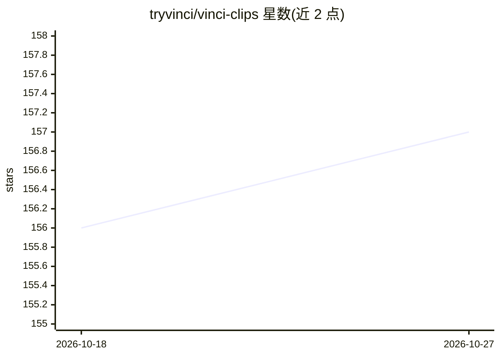

# tryvinci/vinci-clips

⭐ 157 · TypeScript · NOASSERTION · 推送 2026-06-19 · [GitHub](https://github.com/tryvinci/vinci-clips) · [官网](https://tryvinci.com/clips) · 组织维护

**开源 AI 视频剪辑平台：长视频自动转社交媒体短视频**

面向创作者、营销人员与企业的视频剪辑平台：上传长视频（上限 2GB）后，系统经 FFmpeg 抽取音频，调用 Google Gemini API 生成带说话人分离和时间戳对齐的转录，并给出建议片段以生成短视频，附带 TikTok/Reels 风格字幕渲染。技术栈为 Next.js 15 前端、Express 后端、MongoDB 存储、Google Cloud Storage 云存储。运行需 Node.js 18+、FFmpeg、MongoDB 与 Gemini API key；主体功能已标完成，部分改进项仍在计划中。

## 筛选速览

| 维度 | 判定 | 备注 |
|---|---|---|
| AI 角色 | `ai-native` | 本体是模型或模型工具 |
| 许可风险 | `none` | NOASSERTION |
| 部署形态 | `self-host` | docker 或自建部署 |
| 模型依赖 | — | README 未给出锁定关系 |
| 硬件要求 | — | 无带数字的原话,不猜 |
| 安装摩擦 | `low` | 无编译、无系统依赖或容器化 |
| 成熟度 | — | 结构信号不足 |

## 能力要点

- AI 转录含说话人分离与时间戳对齐（Google Gemini API）
- AI 建议片段或手动选取时间区间生成短视频
- TikTok/Reels 风格字幕（5 种样式，SRT+FFmpeg 渲染）
- 批量上传队列管理与实时处理状态跟踪

## 适用场景

- 把播客/直播等长视频切成适合社交平台的短视频
- 获得带说话人标记和时间戳的视频转录稿
- 给短视频自动加 TikTok 风格字幕

## 场景标签

`图像视频处理` `语音识别` · 领域:感知与多模态

## 证据(README 行号)

> L19: - **Intelligent Video Analysis**: AI-powered content analysis using Google Gemini API
> L21: - **Smart Clip Generation**: AI suggests optimal clip segments based on content analysis
> L122:  - Creates AI-powered transcription with speaker identification

## 星数曲线

2026-10-18 156 → 2026-10-27 157（+1）

---
*卡片 v1 · prompt 1.4 · 生成 2026-10-22 · 置信度 high · 依据 README sha `e9608c11c6d0` · [字段定义](../../DATASET.md)*
